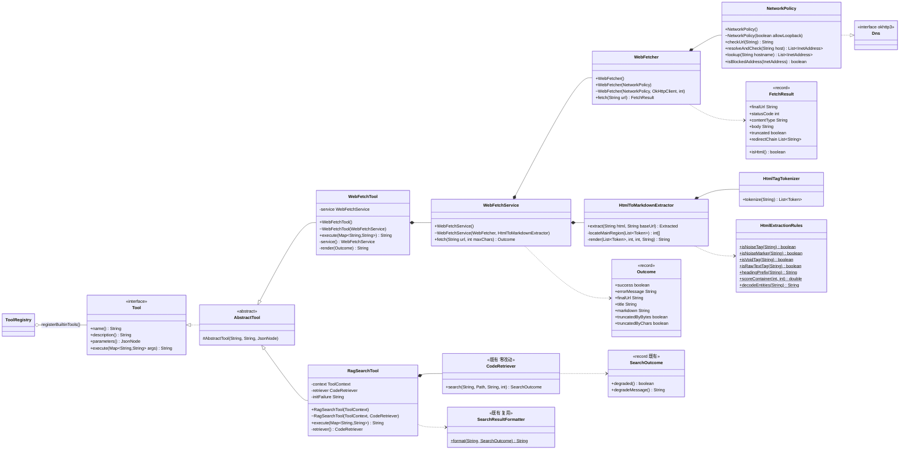
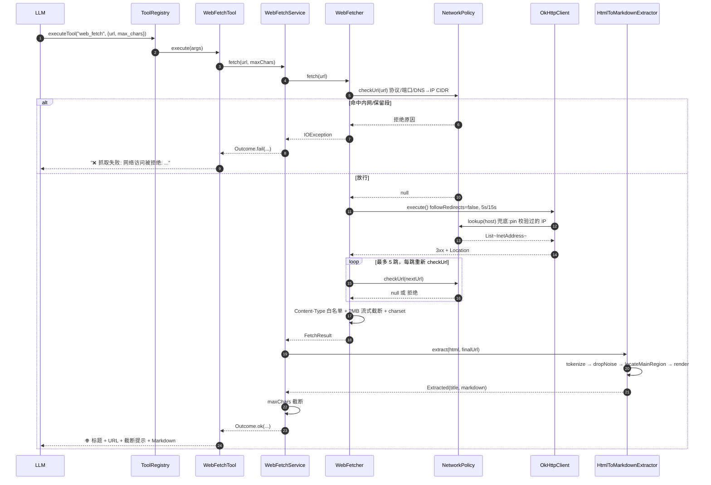
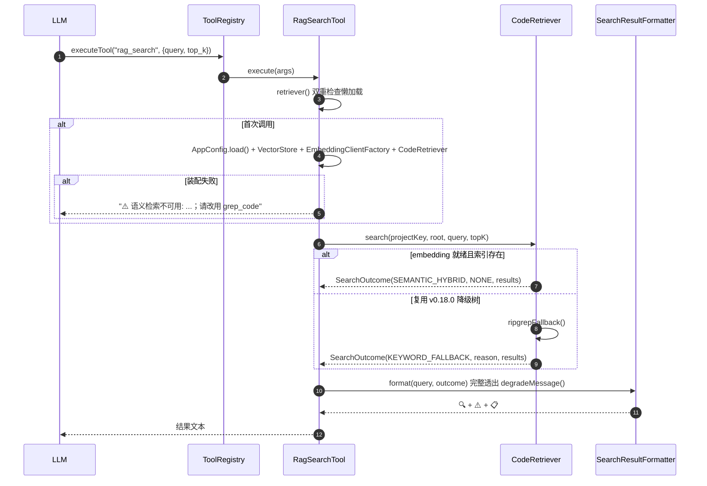
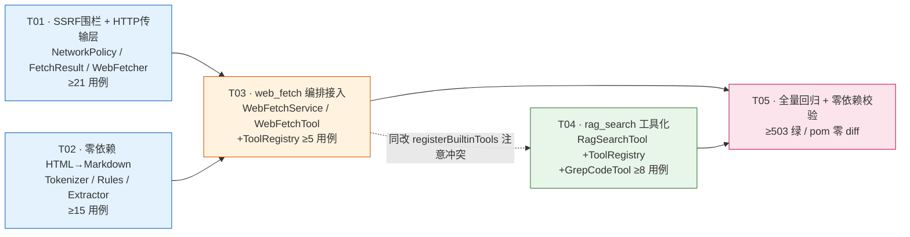

# AgentCLI v0.19.0 · 联网闭环与检索工具化 — 系统架构设计 + 任务分解

> 角色：架构师（高见远 / Gao）｜阶段：架构设计（交付工程师实现 → QA 测试）
> 项目：AgentCLI（Java 17 + Maven，ReAct 范式命令行 AI 编程助手；根 `D:/myfiles/share/study/java_project/paicli`）
> 配套图：类图 `docs/class-diagram.mermaid`；时序图 `docs/sequence-diagram.mermaid`
> 上一版归档：`docs/system_design_v0.14.0.md`
> **前置核对：下列结论均来自实际 Read 源码，非凭记忆假设（详见第 0 节）。**

---

## 0. 范围、硬约束与源码核对结论

**目标（v0.19.0，来自 ROADMAP §1.3）**
- **A. web_fetch**：抓取任意 URL 原文 + 零依赖 HTML→Markdown 提取，与既有 `web_search` 组成「搜索 → 抓取 → 归纳」闭环，自带 SSRF 安全围栏。
- **B. rag_search**：把既有 `rag/CodeRetriever` 包装为 Agent 工具，与 `grep_code` 组成「语义 / 关键词」双路。

**硬约束**
1. **零新增依赖**：`pom.xml` 必须零 diff。正文抽取**不得引 jsoup**，手写零依赖提取器。
2. **不破坏既有契约**：`Tool` 接口、`AbstractTool`、`ToolRegistry` 公开签名不变；`CodeRetriever` **零改动复用**。
3. **不抛方法**：工具 `execute` 全链路吸收异常，最坏返回单行错误文本，绝不把堆栈捅给用户/模型。
4. **测试全量绿**：现有 454 用例不回归，新增 ≥25（本设计给出 ≥41），全量 ≥479。

### 0.1 源码核对结论（决定设计的关键事实）

| # | 待核实项 | 核实结果（含文件:行） | 对设计的影响 |
|---|----------|----------------------|--------------|
| 1 | 工具基类与注册机制 | ✅ `tool/Tool.java:13` 接口四方法（`name/description/parameters/execute`）；`tool/AbstractTool.java:8` 固化前三项，子类只实现 `execute(Map<String,String>)`；`tool/ToolRegistry.java:58` `registerBuiltinTools()` 内 8 行 `register(new XxxTool(...))`。 | 两个新工具**继承 `AbstractTool`**，在 `registerBuiltinTools()` 各加一行。**无需改任何接口**。 |
| 2 | 工具参数 Schema 怎么写 | ✅ `tool/ToolSchema.java:33` `object(Param...)` + `required/optional(name,type,desc)`。 | 直接复用，不自造 Schema 样板。 |
| 3 | 参数解析与钳制 | ✅ `tool/ToolArgs.java` 提供 `str/parseInt/parseBoolean/clamp`；`GrepCodeTool:59-64` 是标准用法范例（`clamp(parseInt(...), min, max)`）。 | `web_fetch` 的 `max_chars`、`rag_search` 的 `top_k` 一律走 `clamp(parseInt())`。 |
| 4 | 工具错误处理风格 | ✅ `ToolRegistry.doExecuteTool:179-192` 统一兜底：`PolicyException`→`🛡️ 策略拒绝`，其他异常→`工具执行失败`；**业务错误由工具自己返回普通文本**（`WebSearchTool:48` 返回 `"搜索关键词不能为空"`，`:54` 返回 `"⚠️ " + hint`）。 | 新工具的业务错误（URL 非法、被围栏拒绝、检索不可用）**返回文本而不抛**，只让真正的意外走 Registry 兜底。 |
| 5 | 外部依赖懒加载风格 | ✅ `WebSearchTool.provider():64-75` 双重检查锁 + `volatile`，构造期不碰网络/环境。 | `WebFetchTool.service()` 与 `RagSearchTool.retriever()` **完全照抄这个模式**。 |
| 6 | 测试注入口子风格 | ✅ 包级可见构造器：`WebSearchTool(SearchProvider):39`、`SearxngSearchProvider(String, OkHttpClient):43`、`WebFetcher(int, OkHttpClient)`（参考实现）。 | 新类一律提供**包级可见**测试构造器，测试与被测类同包。 |
| 7 | `ToolRegistry` 能否拿到 `AppConfig`？ | ❌ **不能**。`ToolRegistry(String projectPath)` 只有路径（`:48`），`registerBuiltinTools()` 在构造器内同步执行（`:55`）。而 RAG 需要 `AppConfig` + SQLite（`RagCommandHandler.create:81-95`）。**全仓 20+ 处 `new ToolRegistry(...)`**（测试为主）。 | **决定性约束**：`RagSearchTool` **绝不可**在构造期装配 SQLite，否则每次 `new ToolRegistry()` 都开库，测试大面积变慢甚至失败。→ 必须懒加载，且自己 `AppConfig.load()`（`common/AppConfig.java:212` 是**静态**方法，可行）。 |
| 8 | RAG 装配所需 API | ✅ `new VectorStore(SqliteStore.defaultStore())` + `EmbeddingClientFactory.create(config)` + `new CodeRetriever(store, embedding, new RipgrepCodeSearchEngine(CodeSearchEngine.EXCLUDED_DIRS))`（`RagCommandHandler:83-87`）。 | `RagSearchTool` 复刻这四行，**不复用 `RagCommandHandler`**（它绑定会话根、含一次性提示策略，与工具语义冲突，见 §1.4）。 |
| 9 | `CodeRetriever` 契约 | ✅ `search(projectKey, projectRoot, query, topK)` 返回 `SearchOutcome`，**明确"绝不抛异常"**（`:86`）；`SearchOutcome.degraded()/degradeMessage()`（`:383/388`）；`DegradeReason` 五枚举带文案模板（`:325-365`）。 | 降级自述**零成本**：直接透出 `degradeMessage()`。 |
| 10 | 检索结果排版 | ✅ `rag/SearchResultFormatter.format(query, outcome):32` 已处理降级行 + 空结果 + 逐条排版。 | `rag_search` **直接复用**，保证 `/search` 与工具输出一致。 |
| 11 | `projectKey` 怎么算 | ✅ `VectorStore.projectKey(Path):53` 静态方法。 | 每次 `execute` 用 `context.projectPath()` 现算，支持会话中途 `setProjectPath` 切换。 |
| 12 | web 包现状 | ✅ `web/` 已有 `SearchProvider/SearchProviderFactory/SearchResult/` + 三 provider。**`FetchResult`、`WebFetcher`、`NetworkPolicy` 在 AgentCLI 侧均不存在**。 | 9 个新文件全是新增，与既有 6 文件同包共存，无命名冲突。 |
| 13 | MockWebServer 可用性 | ✅ **`pom.xml:69-74` 已声明 `mockwebserver:4.12.0` (test scope)**，且 `web/SearxngSearchProviderTest.java`、`llm/` 下 7 个测试已在用。 | 网络测试**零新增依赖**即可做。7 条 pom 声明 = 5 运行时 + JUnit + MockWebServer，**验收「pom 零 diff」天然成立**。 |
| 14 | 代码质量红线 | ⚠️ `quality/SourceQualityScanTest.java:16-21` 扫描 **`src/` 全树**的 `.java/.md/.xml/.yml/.properties`，禁止出现 `com.paicli`、`paicli_`、`~/.paicli`、`" paicli "`。 | **新增代码的注释里严禁写参考实现的全限定包名**，否则该测试立刻挂。对比说明只能写在 `docs/`（不在扫描范围）。已写入 §7 共享知识。 |
| 15 | 现有测试基数 | ✅ `grep -c "@Test\|@ParameterizedTest" src/test` = **454**，与 ROADMAP 一致。 | 目标 ≥479 → 至少 +25；本设计规划 **+41**，余量充足。 |

### 0.2 参考实现实测对照（**纠正需求中的一处事实错误**）

> ⚠️ **需求原文称「参考实现没有 SSRF 围栏」——这与实测不符，必须纠偏，否则叙事讲错。**
> 实测 `_reference/src/main/java/com/paicli/web/NetworkPolicy.java` **确实存在（131 行）**，已实现 scheme 白名单、loopback/anyLocal/linkLocal/siteLocal 拦截、token bucket 限流。

真实增量价值应表述为「**围栏从"调用方自觉"升级为"传输层强制"，并补齐四个可被利用的绕过缺口 + 零依赖替代 Jsoup**」。逐项实测对照：

| 维度 | 参考实现（实测） | 本版设计 | 是否真增量 |
|------|-----------------|---------|-----------|
| 围栏是否存在 | ✅ 有 `NetworkPolicy` | ✅ 有 | ❌ 不是首创 |
| **围栏调用位置** | ⚠️ 在 `ToolRegistry.webFetch():914` 调用；**`WebFetcher.fetch()` 内部零校验**，任何绕过 ToolRegistry 的调用点都裸奔 | ✅ **下沉进 `WebFetcher` 内部**，传输层强制，无法绕过 | ✅ **是** |
| **重定向每跳校验** | ❌ 用默认 `OkHttpClient`（`followRedirects=true`），重定向**完全不经过围栏**——`http://evil.com` 302 → `http://169.254.169.254/` 可直接打穿云元数据 | ✅ `followRedirects(false)` + 手动 5 跳循环，**每跳重走完整 `checkUrl`** | ✅ **是（可利用漏洞）** |
| **DNS rebinding** | ❌ `checkUrl` 解析一次 DNS 校验，OkHttp 建连时**再解析一次**，两次之间存在 TOCTOU 窗口 | ✅ `NetworkPolicy` 兼作 `okhttp3.Dns`，建连用的就是校验过的 IP，**窗口消失** | ✅ **是** |
| **IPv6 `fc00::/7`** | ❌ `isSiteLocalAddress()` 对 IPv6 仅覆盖已废弃的 `fec0::/10`，**ULA `fc00::/7` 漏网** | ✅ 显式字节级 CIDR 判定 | ✅ **是** |
| 端口黑名单 | ❌ 无 | ✅ 有 | ✅ 是 |
| Content-Type 白名单 | ❌ 无 | ✅ 有 | ✅ 是 |
| 169.254/16 云元数据 | ✅ 已被 `isLinkLocalAddress()` 覆盖 | ✅ 覆盖 | ❌ 不是增量（**勿夸大**） |
| 体积 / 超时 | 5MB / 30s 单档 `callTimeout` | 2MB / connect 5s + read 15s 分级 | ➖ 参数收紧 |
| HTML 提取 | **Jsoup 1.18.1 依赖**（`pom.xml.orig:98-100`） | **零依赖手写状态机** | ✅ **是（核心）** |
| 测试是否进 CI | ❌ `WebFetcherTest` 被 surefire `<exclude>` 排除（`pom.xml.orig:205`） | ✅ 全部进 CI（靠 §1.5 的回环开关） | ✅ **是** |

---

## 1. 实现方案 + 框架选型

### 1.1 选型总表（全部复用现有依赖，零新增）

| 能力 | 复用项 | 说明 |
|------|--------|------|
| HTTP 抓取 | **OkHttp 4.12.0**（既有） | 用 `followRedirects(false)` 手动控重定向；用 `Dns` 接口注入围栏；`byteStream()` 流式读取限额 |
| DNS 解析 + IP 判定 | **JDK `java.net.InetAddress`** | `getAllByName` / `getAddress()` 拿原始字节做 CIDR 位运算，无需第三方 IP 库 |
| URL 解析 / 相对转绝对 | **JDK `java.net.URI`** + OkHttp `HttpUrl` | `URI.resolve()` 处理相对 `Location` 与相对 `href` |
| HTML → Markdown | **纯 JDK 手写**（状态机 + 局部正则） | 见 §1.2，**替代 Jsoup 的核心** |
| HTML 实体解码 | **纯 JDK 手写**（`HtmlExtractionRules.decodeEntities`） | Jsoup 原本免费提供，自研必须补上，**易漏项** |
| JSON（Schema/参数） | **Jackson**（既有） | 经 `ToolSchema` 间接使用 |
| 日志 | **Logback + SLF4J**（既有） | 与 `SearxngSearchProvider:30` 同风格 |
| 测试 HTTP | **MockWebServer**（既有 test scope） | 见 §7.5 |

**架构模式**：三层严格分层（工具外壳 / 编排 / 能力），依赖单向向下，每层可独立单测。

### 1.2 零依赖 HTML→Markdown 怎么落地（核心技术方案）

**为什么不能只用正则**：HTML 有三个正则天然处理不了的特性——① `<script>` 内部的 `<` `>` 不是标签；② 属性值引号内可以有 `>`；③ 注释 `<!-- <div> -->` 内的标签不算标签。这些都需要**状态**。因此：

> **状态机负责"切分"（有状态、全局），正则只负责"清洗"（无状态、局部）。**

**三个类分工（职责单一、可独立测试）**：

**① `HtmlTagTokenizer` — 手写状态机扫描器**
单遍 `char[]` 扫描，输出扁平 `List<Token>`。状态集：
```
TEXT → TAG_OPEN → TAG_NAME → BEFORE_ATTR → ATTR_NAME → AFTER_ATTR_NAME
     → BEFORE_ATTR_VALUE → ATTR_VALUE_DQ / ATTR_VALUE_SQ / ATTR_VALUE_UNQUOTED
     → SELF_CLOSING_START → COMMENT → DOCTYPE → RAWTEXT
```
- **`RAWTEXT` 模式是关键**：进入 `<script>`/`<style>` 后，只扫描匹配的 `</script>`，中间所有 `<` 一律当文本。这是正则方案必然出错的地方。
- **防爆保护**：token 数上限 200k，超限截断并标记——畸形 HTML（如 10 万个未闭合 `<div>`）不会撑爆内存。
- **不建 DOM 树**：省掉 Jsoup 最重的部分，也是零依赖可行的前提。

**② `HtmlExtractionRules` — 纯静态规则表**
全部 `static` 纯函数，无状态、无 IO。抽出来独立成类的价值：**规则可单独调参和单测，不与遍历算法纠缠**。
- 噪声标签集：`script,style,noscript,iframe,nav,aside,header,footer,form,svg,canvas,button`
- 噪声 class/id 关键词：`ads,advert,banner,popup,modal,subscribe,newsletter,related,recommend,comment,share,social,breadcrumb,sidebar,promo,cookie,navigation`
- void 标签集（无闭合）：`br,img,hr,meta,link,input,source,area,base,col,embed,param,track,wbr`
- 正文打分：`score = textLen × (1 − min(linkRatio × 2, 1))`，`textLen < 80` 记 0 分（链接密度高 → 大概率是导航/列表页）
- `decodeEntities()`：命名实体（`&amp; &lt; &gt; &quot; &apos; &nbsp;` 等约 20 个高频）+ 数字实体（`&#NNN;` / `&#xHH;`）

**③ `HtmlToMarkdownExtractor` — 两阶段消费 token 流**
因为不建 DOM，用**两阶段扫描**代替树遍历：
- **Phase 1 `locateMainRegion`**：走一遍 token 流，用一个栈记录块级容器的起止索引，统计各容器的文本长度与链接文本长度，调 `scoreContainer` 打分，选出最佳区间 `[start, end)`。语义容器（`<article>`/`<main>`/`role=main`）文本 > 80 时直接命中，跳过打分。
- **Phase 2 `render`**：只渲染该区间，**用显式栈而非递归**（深度上限 512）。这是「畸形 HTML」验收项的关键——递归遇到深嵌套会 `StackOverflowError`，显式栈只会到上限后平坦化。

未闭合标签的容错：Phase 1 遇到未闭合容器，用「下一个同级块起点」或区间末尾兜底，**不修复 HTML，只保证不崩**。

### 1.3 SSRF 围栏落点（明确回答草稿遗留问题）

**规则归属：全部归 `NetworkPolicy`。** 理由：
1. **可测试性**：`NetworkPolicy` 是纯判定（除 DNS 外无 IO），验收标准要求的「SSRF 内网拦截用例」可以**完全脱网**，直接构造 `10.0.0.1` / `169.254.169.254` / `[::1]` / `[fc00::1]` 字符串断言拒绝原因。若把规则塞进 `WebFetcher`，每条围栏用例都得起 HTTP 服务，慢且脆。
2. **单一事实来源**：`WebFetcher` 只是**调用点**（且是多个调用点：首跳 + 每个重定向跳 + Dns 回调），不是**规则持有者**。规则散落必然漂移。
3. **参考实现的教训**：参考把校验放在 `ToolRegistry` 里，`WebFetcher.fetch()` 自身裸奔——换个调用方就绕过了。本版**把调用下沉进 `WebFetcher`，把规则留在 `NetworkPolicy`**，两者都归位。

**双层防御（本设计技术要点）**：

| 层 | 机制 | 解决什么 | 可测性 |
|----|------|---------|--------|
| **显式层** | `WebFetcher` 关自动重定向，手动循环 ≤5 跳，每跳前调 `policy.checkUrl(nextUrl)` | 重定向绕过；**能给出精确错误**（"重定向第 2 跳被拒绝: 禁止访问链路本地地址"） | 高：MockWebServer 发 302 即可测 |
| **兜底层** | `NetworkPolicy implements okhttp3.Dns`，装进 `OkHttpClient.Builder().dns(policy)` | **DNS rebinding / TOCTOU**：建连用的 IP 就是校验过的那个，中间无二次解析窗口 | 中：直接调 `policy.lookup("10.0.0.1")` 断言抛 `SsrfBlockedException` |

`okhttp3.Dns` 是 OkHttp 自带接口（`Dns.SYSTEM` 的抽象），**实现它不引入任何依赖**。

**围栏清单**（`NetworkPolicy` 内实现）：
- 协议白名单：仅 `http` / `https`
- 端口黑名单：`22,23,25,110,143,445,3306,5432,6379,9200,11211,27017` 等
- IPv4 私有/保留：`127.0.0.0/8`、`10.0.0.0/8`、`172.16.0.0/12`、`192.168.0.0/16`、`169.254.0.0/16`（云元数据）、`0.0.0.0/8`
- IPv6：`::1`、`fc00::/7`（ULA，**参考实现漏网项**）、`fe80::/10`（链路本地）、IPv4-mapped 拆出内嵌 v4 再判
- 字面量黑名单：`localhost`、`*.localhost`、`0.0.0.0`（DNS 未解析也直接拒）
- 响应体 2MB 流式截断、connect 5s / read 15s、Content-Type 白名单（在 `WebFetcher` 执行，规则常量仍在 `NetworkPolicy`/`WebFetcher` 各自内聚）

### 1.4 `WebFetcher` 与 `WebFetchService` 边界（明确回答草稿遗留问题）

草稿未定的边界，按「**一层只懂一件事**」切开：

| 类 | 职责 | **懂什么** | **不懂什么** |
|----|------|-----------|-------------|
| `WebFetcher` | HTTP 传输 | OkHttp、重定向、超时、字节流、charset、Content-Type、`NetworkPolicy` | **完全不懂 HTML / Markdown / max_chars** |
| `WebFetchService` | 业务编排 | `FetchResult` → 按 contentType 分派 → 提取 → 字符截断 → 组装 `Outcome` | **完全不懂 OkHttp / 状态机内部** |
| `WebFetchTool` | 工具外壳 | 参数 Schema、参数钳制、结果排版成给模型看的文本 | **不含任何业务逻辑** |

判据：`WebFetcher` 换成 HttpClient 实现，`WebFetchService` 一行不用改；`HtmlToMarkdownExtractor` 换算法，`WebFetcher` 一行不用改。

**为什么保留 `WebFetchService` 而不让 Tool 直接调 Fetcher**：`web_fetch` 有真实编排逻辑（HTML 走提取器 / `text/plain` 直通 / 两种截断语义合并 / 重定向链汇报），塞进 Tool 会让工具外壳变胖且难测；`WebFetchService.fetch()` 返回结构化 `Outcome`，可脱离工具层单测。

### 1.5 可测试性关键设计：回环地址开关（**否则测试根本跑不起来**）

> 🔴 **必须解决的冲突**：`MockWebServer` 监听 `127.0.0.1`，而围栏要拦 `127.0.0.0/8`。若无开关，`WebFetcherTest` 的每个用例都会被自己的围栏拒绝。**这极可能就是参考实现把 `WebFetcherTest` 排除出 CI 的真实原因**（`pom.xml.orig:205`）。

方案：`NetworkPolicy` 提供**包级可见**构造器 `NetworkPolicy(boolean allowLoopback)`：
- `public NetworkPolicy()` → `allowLoopback = false`（**生产路径唯一入口，永远禁回环**）
- `NetworkPolicy(true)` → 仅**同包测试**可用，放行 loopback，其余围栏（私有段/端口/协议/重定向）**照常生效**

这样 `NetworkPolicyTest` 用生产构造验证拦截，`WebFetcherTest` 用 `true` 配 MockWebServer 验证截断/超时/重定向，**两类用例全部进 CI，无一被排除**。与既有包级可见测试构造器风格（核对项 #6）完全一致。

### 1.6 `rag_search` 复用策略

- **`CodeRetriever` 零改动**：`search()` 已承诺不抛、已内置完整降级树，直接调。
- **不复用 `RagCommandHandler`**：① 它构造期就装配 SQLite，违反核对项 #7；② 它的**「降级提示一次性显示」策略**（`:203-213`）对 CLI 用户合理（避免告警脱敏），但对 LLM **有害**——模型每轮独立读 tool 结果，第二轮起抹掉 `⚠️` 会让模型误以为语义检索生效。**工具侧每次都完整透出降级信息**。
- **懒加载 + 失败自述**：装配失败缓存原因，返回 `⚠️ 语义检索不可用: <原因>；请改用 grep_code 关键词检索` —— 既自述降级又给出可执行的下一步。
- **排版复用 `SearchResultFormatter.format()`**，保证 `/search` 与 `rag_search` 输出一致。

**工具选择策略必须写进 `description`**（否则模型不知道何时用哪个），拟定文案：

> `rag_search`：语义检索项目代码，回答"某功能是怎么实现的/在哪里"这类**自然语言、不知道确切符号名**的问题；先建索引（`/index`）效果最佳，无索引时自动降级为关键词兜底。**已知确切类名/方法名/字符串时请改用 `grep_code`**（更快更准）。

对称地，`grep_code` 现有 description 已含「适合精确符号/字符串定位」，**本版补一句反向指引**（见 §2 修改清单）。

---

## 2. 文件列表（相对路径 · 全部位于 `src/main/java/com/agentcli/` 与 `src/test/java/com/agentcli/`）

### 2.1 新建 — 主代码（9 个）

| # | 相对路径 | 包 | 职责 | 预估行 |
|---|---------|-----|------|-------|
| 1 | `web/NetworkPolicy.java` | `com.agentcli.web` | SSRF 围栏唯一规则源；兼作 `okhttp3.Dns` | ~200 |
| 2 | `web/FetchResult.java` | `com.agentcli.web` | record：一次 HTTP 抓取的原始产物 | ~45 |
| 3 | `web/WebFetcher.java` | `com.agentcli.web` | HTTP 传输层：手动重定向 + 每跳校验 + 2MB 流式截断 + 分级超时 | ~190 |
| 4 | `web/HtmlTagTokenizer.java` | `com.agentcli.web` | 手写状态机，HTML → `List<Token>` | ~230 |
| 5 | `web/HtmlExtractionRules.java` | `com.agentcli.web` | 纯静态规则表 + 实体解码 + 打分 | ~150 |
| 6 | `web/HtmlToMarkdownExtractor.java` | `com.agentcli.web` | 两阶段：定位正文区间 → 显式栈渲染 Markdown | ~250 |
| 7 | `web/WebFetchService.java` | `com.agentcli.web` | 编排：抓取 → 分派 → 提取 → 截断 → `Outcome` | ~110 |
| 8 | `tool/builtin/WebFetchTool.java` | `com.agentcli.tool.builtin` | `web_fetch` 工具外壳 | ~110 |
| 9 | `tool/builtin/RagSearchTool.java` | `com.agentcli.tool.builtin` | `rag_search` 工具外壳 + 懒装配 | ~120 |

### 2.2 修改 — 主代码（2 个）

| 相对路径 | 改动内容 |
|---------|---------|
| `tool/ToolRegistry.java` | ① `import` 两个新工具；② `registerBuiltinTools()` 内加 `register(new WebFetchTool());` 与 `register(new RagSearchTool(context));`。**其余零改动** |
| `tool/builtin/GrepCodeTool.java` | 仅 description 末尾补反向指引：「不知道确切符号名、想按语义找实现时用 `rag_search`」。**代码逻辑零改动** |

### 2.3 新建 — 测试（6 个，≥41 用例）

| 相对路径 | 用例数 | 覆盖点 |
|---------|-------|-------|
| `web/NetworkPolicyTest.java` | **≥12** | 协议白名单（ftp/file/gopher 拒）；127.0.0.1、10.x、172.16-31.x、192.168.x、**169.254.169.254 云元数据**、0.0.0.0、`localhost`、`::1`、**`fc00::1`（参考漏网项）**、`fe80::1`、IPv4-mapped `::ffff:10.0.0.1`；端口黑名单；公网地址放行；`lookup()` 抛 `SsrfBlockedException` |
| `web/WebFetcherTest.java` | **≥9** | 正常 200；**超大响应 2MB 截断**（`truncated=true` 且不 OOM）；**读超时**（MockWebServer `setBodyDelay`）；**重定向到内网被拒**（302 → `http://10.0.0.1/`）；重定向链记录；**超过 5 跳拒绝**；Content-Type 非白名单拒绝；charset 解析（GBK/UTF-8）；4xx/5xx 错误信息 |
| `web/HtmlTagTokenizerTest.java` | **≥6** | 基本标签/属性；**`<script>` 内含 `<` 不误切**；属性值内含 `>`；注释跳过；self-closing；**未闭合标签不抛异常** |
| `web/HtmlToMarkdownExtractorTest.java` | **≥9** | 标题提取（`<title>` / `<h1>` 兜底）；`<article>` 优先；打分选正文（高链接密度 nav 被排除）；噪声标签剔除；class 含 `sidebar` 剔除；h1-h6/p/ul/ol/pre/code/blockquote/table/a 转换；相对链接转绝对；**实体解码**；**畸形 HTML（深嵌套 1000 层 + 未闭合）不崩** |
| `tool/builtin/WebFetchToolTest.java` | **≥5** | 空 URL 提示；`max_chars` 钳制与截断提示；成功排版含最终 URL；Service 返回失败时单行错误；schema 含 `url`/`max_chars` |
| `tool/builtin/RagSearchToolTest.java` | **≥6** | 空 query 提示；`top_k` 钳制；语义结果排版；**降级时 `⚠️` 完整透出**；**连续两次调用都透出降级**（区别于 `/search` 一次性策略）；装配失败返回不可用提示且不抛 |

### 2.4 修改 — 测试（1 个）

| 相对路径 | 改动 |
|---------|------|
| `tool/ToolRegistryTest.java` | +2 用例：`hasTool("web_fetch")`、`hasTool("rag_search")` 为 true，且 `getToolDefinitions()` 含两者 |

**测试增量汇总**：12+9+6+9+5+6+2 = **≥49 用例** → 454 + 49 = **≥503**，显著超过 479 门槛。

---

## 3. 数据结构与接口（类图）

> 完整图见 `docs/class-diagram.mermaid`。以下为关键契约摘要（工程师按此签名实现）。



### 3.1 两个工具的参数 Schema（工程师照此写 `ToolSchema.object(...)`）

**`web_fetch`**
| 参数 | 类型 | 必填 | 默认 / 钳制 | 描述 |
|------|------|------|------------|------|
| `url` | string | ✅ | — | 要抓取的网页 URL，必须以 http:// 或 https:// 开头 |
| `max_chars` | integer | ❌ | 默认 20000，`clamp(1000, 60000)` | 返回正文的最大字符数，超出截断 |

**`rag_search`**
| 参数 | 类型 | 必填 | 默认 / 钳制 | 描述 |
|------|------|------|------------|------|
| `query` | string | ✅ | — | 自然语言描述，如"用户登录是怎么实现的" |
| `top_k` | integer | ❌ | 默认 5，`clamp(1, 20)` | 返回结果条数 |

---

## 4. 程序调用流程（时序图）

> 完整图（含每跳围栏、DNS 兜底、两阶段提取、降级分支）见 `docs/sequence-diagram.mermaid`。以下为主干摘要。





---

## 5. 任务列表（有序 · 含依赖 · 每项标注文件）

### T01 · SSRF 安全围栏与 HTTP 传输层 `P0`
- **文件**：新建 `web/NetworkPolicy.java`、`web/FetchResult.java`、`web/WebFetcher.java`；新建测试 `web/NetworkPolicyTest.java`、`web/WebFetcherTest.java`
- **交付**：围栏规则全集（协议/端口/v4v6 CIDR/字面量）+ `okhttp3.Dns` 实现 + `SsrfBlockedException`；`WebFetcher` 手动 5 跳重定向逐跳校验、2MB 流式截断、5s/15s 分级超时、Content-Type 白名单、charset 解析
- **依赖**：无（可立即开工）
- **验收**：≥21 用例绿；`NetworkPolicyTest` **不起任何 HTTP 服务**；`WebFetcherTest` 用 `NetworkPolicy(true)` + MockWebServer 且**不被 surefire 排除**

### T02 · 零依赖 HTML→Markdown 提取器 `P0`
- **文件**：新建 `web/HtmlTagTokenizer.java`、`web/HtmlExtractionRules.java`、`web/HtmlToMarkdownExtractor.java`；新建测试 `web/HtmlTagTokenizerTest.java`、`web/HtmlToMarkdownExtractorTest.java`
- **交付**：状态机切分（含 RAWTEXT 模式）、静态规则表、实体解码、两阶段正文定位与显式栈渲染
- **依赖**：无（**与 T01 完全独立，可并行**）
- **验收**：≥15 用例绿；**全文件不出现任何 `org.jsoup` import**；畸形 HTML 用例（深嵌套 + 未闭合）不抛异常

### T03 · web_fetch 编排与工具接入 `P0`
- **文件**：新建 `web/WebFetchService.java`、`tool/builtin/WebFetchTool.java`；新建测试 `tool/builtin/WebFetchToolTest.java`；**修改 `tool/ToolRegistry.java`**（注册 `web_fetch`）
- **交付**：contentType 分派（HTML→提取器 / text-plain→直通 / 其他→拒绝）、双截断语义合并、`Outcome` 契约、工具排版
- **依赖**：**T01 + T02**
- **验收**：≥5 用例绿；`ToolRegistry.hasTool("web_fetch")` 为 true

### T04 · rag_search 语义检索工具化 `P0`
- **文件**：新建 `tool/builtin/RagSearchTool.java`；新建测试 `tool/builtin/RagSearchToolTest.java`；**修改 `tool/ToolRegistry.java`**（注册 `rag_search`）、**修改 `tool/builtin/GrepCodeTool.java`**（description 补反向指引）、**修改 `tool/ToolRegistryTest.java`**（+2 注册断言）
- **交付**：懒加载装配（构造期不碰 SQLite）、降级完整透出、复用 `SearchResultFormatter`、双路选择策略写进 description
- **依赖**：无（**与 T01/T02 独立，可并行**）
- **⚠️ 冲突提示**：与 **T03 共同修改 `ToolRegistry.registerBuiltinTools()`**。建议 T03 先合，或两者都只加一行以最小化冲突面
- **验收**：≥8 用例绿（含 6 新 + 2 注册断言）；`CodeRetriever` 零改动；`new ToolRegistry()` 不产生 SQLite 文件

### T05 · 全量回归与零依赖校验 `P0`
- **文件**：无新增；校验 `pom.xml`（须零 diff）、全量测试
- **交付**：`mvn test -DskipTests=false` 全绿；`git diff pom.xml` 为空；`grep -rn "jsoup" src/` 无结果；`SourceQualityScanTest` 绿（新代码注释无遗留标识）；`mvn package` 单 jar 可运行，实测 `web_fetch` + `rag_search` 端到端
- **依赖**：**T01 + T02 + T03 + T04**
- **验收**：全量 **≥503** 用例绿（基线 454 + 49）；pom 7 条声明不变

### 5.1 任务依赖图



**推荐实现顺序**：`T01 ∥ T02 ∥ T04` 并行 → `T03` → `T05`。单人串行时按 `T01 → T02 → T03 → T04 → T05`。

---

## 6. 依赖包列表

### 6.1 零新增依赖（**验收硬指标：`pom.xml` 零 diff**）

本版**不新增任何 `<dependency>`**，`pom.xml` 保持 7 条声明（5 运行时 + 2 测试）。

| 依赖 | 版本 | scope | 本版用途 |
|------|------|-------|---------|
| `com.squareup.okhttp3:okhttp` | 4.12.0 | compile | `WebFetcher` HTTP 抓取；`OkHttpClient.Builder.dns()` 注入围栏；`followRedirects(false)` 手动重定向；`HttpUrl` URL 校验 |
| `com.fasterxml.jackson.core:jackson-databind` | 2.16.0 | compile | 经 `ToolSchema` 构建工具参数 JSON Schema；`ToolRegistry` 解析 tool_call 参数 |
| `ch.qos.logback:logback-classic` | 1.5.18 | compile | `WebFetcher` / `RagSearchTool` 的 SLF4J 日志 |
| `org.xerial:sqlite-jdbc` | 3.49.1.0 | compile | `rag_search` 经 `VectorStore` / `SqliteStore` 读索引（既有链路） |
| `org.jline:jline` | 3.26.3 | compile | 本版未直接使用 |
| `org.junit.jupiter:junit-jupiter` | 5.10.2 | test | 全部新增单测 |
| `com.squareup.okhttp3:mockwebserver` | 4.12.0 | test | **已存在**（`pom.xml:69-74`）：`WebFetcherTest` 模拟 302/超时/超大响应/异常 Content-Type |

### 6.2 明确不引入

| 本可引入 | 替代方案 |
|---------|---------|
| ~~`org.jsoup:jsoup`~~ | `HtmlTagTokenizer` 手写状态机 + `HtmlExtractionRules` 手写实体解码（T02） |
| ~~IP/CIDR 工具库~~ | `InetAddress.getAddress()` 原始字节位运算（T01） |
| ~~`commons-text` 等实体解码~~ | `HtmlExtractionRules.decodeEntities()`（T02） |

---

## 7. 共享知识（跨文件约定 · 工程师必读）

### 7.1 工具返回结构约定
- **返回给模型的永远是纯文本 `String`**，不是 JSON（`Tool.execute` 契约）。
- **业务错误返回文本，不抛异常**：只有真正意外才让 `ToolRegistry.doExecuteTool:187-191` 兜底。
- 状态前缀统一（沿用既有）：成功 `🌐`/`🔍`；降级或不可用 `⚠️`；失败 `❌`；策略拒绝由 Registry 统一加 `🛡️`。
- `web_fetch` 成功输出骨架：
  ```
  🌐 <title>
  🔗 <finalUrl>              ← 有重定向时附 "（经 N 跳重定向）"
  ⚠️ 内容已截断（原始 12345 字符，返回前 20000 字符）   ← 仅截断时出现

  <markdown 正文>
  ```

### 7.2 错误与降级如何表达
- **降级 ≠ 失败**：降级时**照常返回结果**，只在首行加 `⚠️` 说明，让模型知道结果成色。
- `rag_search` 的降级文案**直接用 `SearchOutcome.degradeMessage()`**（`CodeRetriever:388`），不自造措辞。
- **每次调用都完整透出降级信息**，不套用 `RagCommandHandler` 的一次性策略（理由见 §1.4）。
- 围栏拒绝文案格式：`❌ 抓取失败: 网络访问被拒绝: <具体原因（含命中的 IP）>`；重定向跳被拒需带跳数：`重定向第 2 跳被拒绝: ...`。

### 7.3 日志规范
- 与 `SearxngSearchProvider:30` 一致：`private static final Logger log = LoggerFactory.getLogger(Xxx.class);`
- `INFO`：一次抓取的 `GET <url>`、最终状态码与耗时。
- `WARN`：围栏拦截、重定向超限、响应截断、RAG 装配失败——**带原因，不带完整堆栈**。
- **禁止**把响应体全文写日志（可能有敏感信息且体积大）。

### 7.4 编码红线
- 🔴 **新增代码的注释/字符串中严禁出现参考实现的全限定包名**（`com.paicli` 等）——`quality/SourceQualityScanTest.java:16-21` 扫 `src/` 全树，命中即挂。对比说明只写在 `docs/`。
- 所有新类**必须写中文 Javadoc**，说明"为什么这么设计"而非"做了什么"（对齐 `CodeRetriever` / `RagCommandHandler` 的注释密度）。
- 生产路径**只允许** `new NetworkPolicy()`（无参）；带 `boolean` 的构造器是包级可见，**仅测试可用**。
- 常量集中在各自类顶部 `private static final`，不散落魔法值。

### 7.5 测试 Mock/Stub 约定（**不依赖真实网络**）

| 测试对象 | 方案 | 要点 |
|---------|------|------|
| `NetworkPolicy` | **纯字符串构造，零 IO** | 直接 `policy.checkUrl("http://169.254.169.254/latest/meta-data/")` 断言返回非 null。**内网 IP 字面量不触发真实 DNS**（`InetAddress.getAllByName("10.0.0.1")` 对点分十进制直接解析，不发查询）。**严禁在围栏用例里用需要真实 DNS 的域名**，否则 CI 断网即挂 |
| `WebFetcher` | **MockWebServer + `NetworkPolicy(true)`** | 回环开关是前提（§1.5）。302 用 `MockResponse().setResponseCode(302).addHeader("Location", "http://10.0.0.1/")`；超大响应用 `setBody(Buffer)` 塞 >2MB；超时用 `setBodyDelay(20, SECONDS)` 配合缩短的测试超时；异常 Content-Type 用 `addHeader("Content-Type","application/zip")` |
| `HtmlTagTokenizer` / `HtmlToMarkdownExtractor` | **纯字符串 in / 字符串 out** | 无需任何 mock，HTML 用 Java 17 text block 内联 |
| `WebFetchService` / `WebFetchTool` | **包级可见构造器注入 Stub** | `new WebFetchTool(stubService)`，stub 直接返回构造好的 `Outcome`，**不起 HTTP** |
| `RagSearchTool` | **包级可见构造器注入假 `CodeRetriever`** | 用匿名子类/简单 stub 返回预设 `SearchOutcome`（含 `KEYWORD_FALLBACK` + `DegradeReason.INDEX_MISSING`），**不开 SQLite、不调 embedding** |
| `ToolRegistryTest` | 直接 `new ToolRegistry(tempDir)` | 只断言注册与定义列表，**不执行**这两个工具 |

**通用**：测试类与被测类**同包**（才能用包级可见构造器）；`MockWebServer` 用 `@BeforeEach start()` / `@AfterEach shutdown()`（照抄 `SearxngSearchProviderTest:19-28`）；**新增测试一律不得加进 surefire `<excludes>`**。

### 7.6 分层依赖方向（不得反向）
```
tool/builtin/WebFetchTool  →  web/WebFetchService  →  web/WebFetcher     →  web/NetworkPolicy
                                                   →  web/HtmlToMarkdownExtractor → web/HtmlTagTokenizer
                                                                                  → web/HtmlExtractionRules
tool/builtin/RagSearchTool →  rag/CodeRetriever（既有，零改动）
```
`web` 包**不得反向依赖** `tool` 包；`HtmlExtractionRules` 是叶子，**不依赖任何本项目类**。

---

## 8. 待明确事项（需主理人/用户拍板）

| # | 事项 | 现状与建议 | 阻塞性 |
|---|------|-----------|-------|
| **1** | **叙事纠偏（最重要）**：需求称「参考实现没有 SSRF 围栏」，**实测不成立**——`_reference/.../web/NetworkPolicy.java` 存在且已覆盖 scheme 白名单与 loopback/siteLocal/linkLocal 拦截（含 169.254/16）。 | 建议对外表述改为「**围栏从"调用方自觉"下沉为"传输层强制"，补齐重定向逐跳校验、DNS rebinding、`fc00::/7`、端口/Content-Type 白名单四类缺口，并零依赖替代 Jsoup**」。§0.2 已给出逐项实测对照表，可直接引用。**请确认采用此表述**。 | 🟡 不阻塞编码，**阻塞对外材料** |
| **2** | 是否保留**限流**（token bucket）？ | 需求 A 未列、验收未考，但参考实现有（60s/30 次），成本极低且能防模型失控刷网。**建议保留**在 `NetworkPolicy.acquire()`，默认 60s/30 次。**若要保留请确认**，否则本版不实现。 | 🟢 不阻塞（默认不实现） |
| **3** | `robots.txt` 是否遵守？ | 需求未提。抓取任意 URL 有合规风险，但实现需额外一次请求 + 解析器（约 +80 行）。**建议本版不做**，在 User-Agent 中标明 `agentcli-web-fetch/1.0` 以便站点识别，留待后续版本。 | 🟢 不阻塞 |
| **4** | 是否需要 `/fetch` REPL 斜杠命令？ | 需求只要求 Agent 工具。`web_search` 也只有工具、无斜杠命令。**建议对齐，不加**。 | 🟢 不阻塞 |
| **5** | 非 HTML 内容（PDF / JSON / XML）如何处理？ | 建议 Content-Type 白名单仅放行 `text/html`、`application/xhtml+xml`、`text/plain`、`text/markdown`；`application/json` **建议一并放行并原文直通**（抓 API 文档很常用）。**请确认是否放行 JSON**。 | 🟡 影响 T01 白名单常量，**开工前需定** |
| **6** | `rag_search` 是否需要 `path` / `glob` 过滤参数？ | `CodeRetriever.search()` 签名不支持范围过滤，加参数需改既有类（违反"零改动复用"）。**建议本版不加**，保持 `query` + `top_k` 两参。 | 🟢 不阻塞 |

---

## 9. 交付物清单

| 类型 | 路径 | 状态 |
|------|------|------|
| 系统设计（本文） | `docs/system_design.md` | ✅ |
| 类图 | `docs/class-diagram.mermaid` | ✅ |
| 时序图 | `docs/sequence-diagram.mermaid` | ✅ |
| 上一版归档 | `docs/system_design_v0.14.0.md` / `class-diagram-v0.14.0.mermaid` / `sequence-diagram-v0.14.0.mermaid` | ✅ |

**规模汇总**：新建主代码 **9** 个（约 1405 行）｜修改主代码 **2** 个（各 1–2 行）｜新建测试 **6** 个（≥47 用例）｜修改测试 **1** 个（+2 用例）｜新增依赖 **0** 个。
