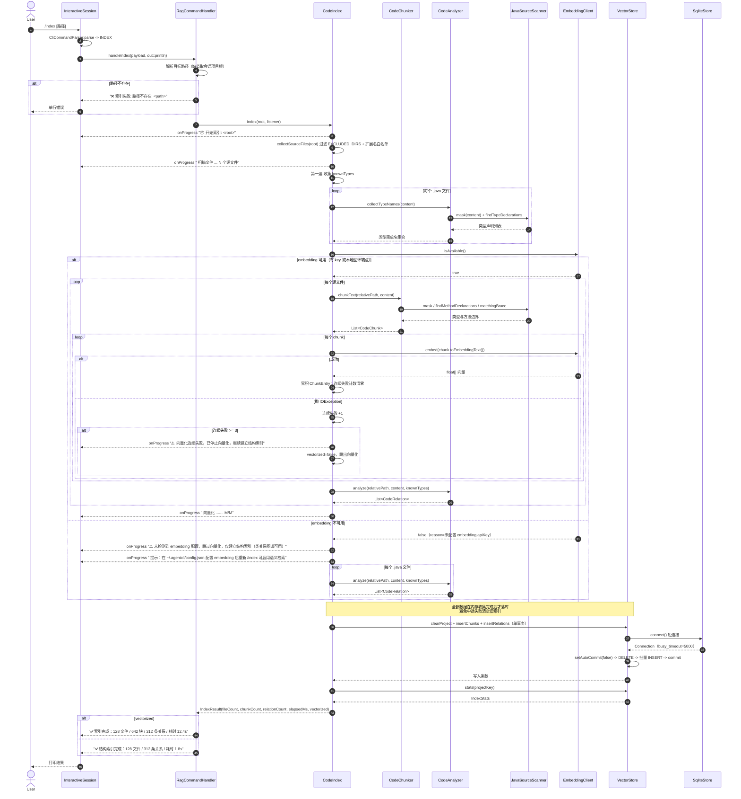
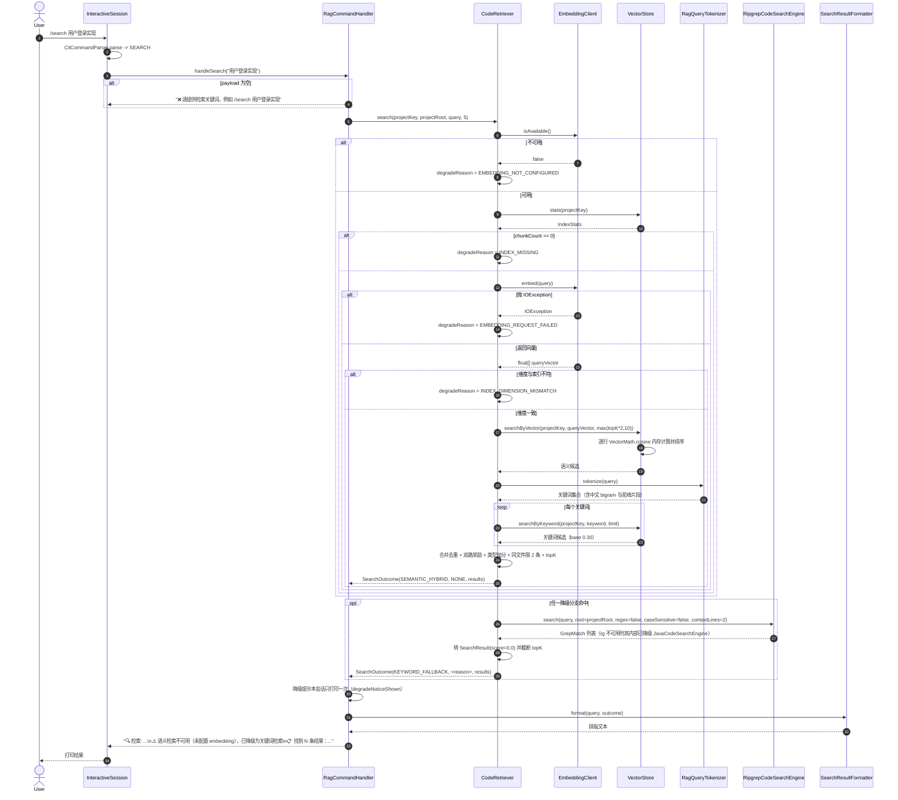
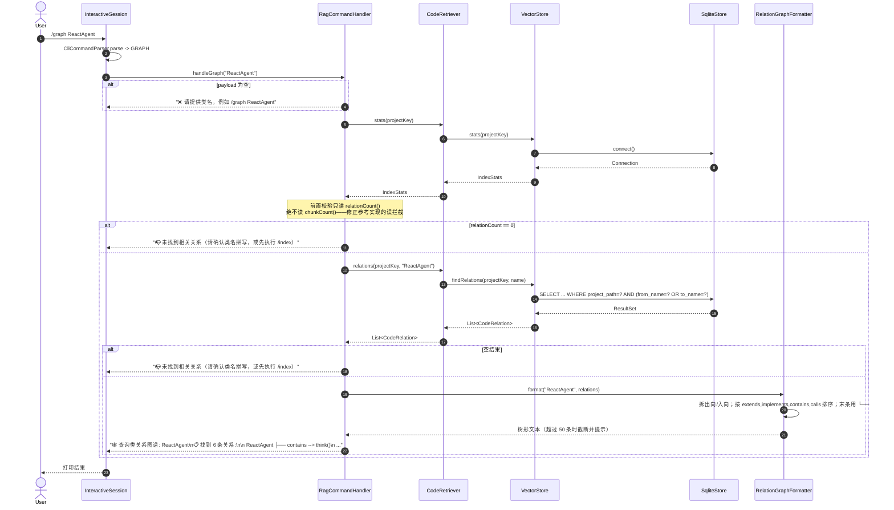
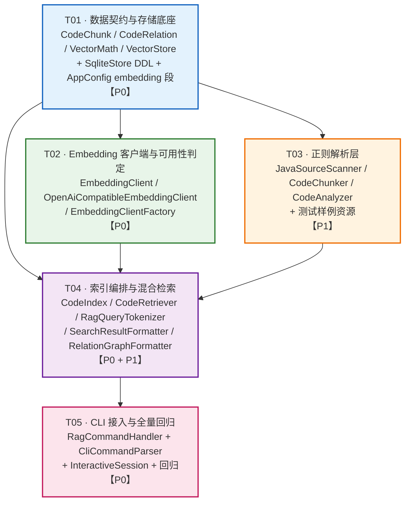

# 系统设计 · AgentCLI v0.18.0 —— RAG 向量索引 + 类关系图谱（/index /search /graph）

> 架构师：高见远　|　上游输入：`docs/PRD_v0.18.0_rag_code_index.md`（产品经理 许清楚）
> 前置版本：v0.17.0（364 用例全绿，零新增依赖）　|　参考快照：`_reference/src/main/java/com/paicli/rag/*`（10 文件已通读）
> 状态：**主理人 6 项决策已全部内化到本设计**，工程师可据此直接批量实现

---

## 0. 主理人决策落位对照表（先对账，再设计）

| # | 主理人决策 | 本设计落位 |
|---|---|---|
| 1 | 不引 JavaParser，正则/Ripgrep 实现 | 新增 `JavaSourceScanner`（掩码 + 花括号配对扫描）作为分块与关系抽取的共同底座；`pom.xml` **零改动** |
| 2 | 单一 OpenAI 兼容 embedding 实现，默认 `https://api.openai.com/v1` + `text-embedding-3-small`；Ollama 靠配置切换；无 key/失败/空索引 → 降级 Ripgrep | `EmbeddingClient` 接口 + `OpenAiCompatibleEmbeddingClient` 唯一实现；`isAvailable()` 对**回环地址放行无 key**（Ollama 场景）；`CodeRetriever` 定义 4 类降级原因，终点一律 Ripgrep |
| 3 | Java 按类/接口/枚举边界 + 方法签名切分；非 Java ~2000 字符定长窗口（带重叠）；单块上限 2000；携带 路径/类型/名称/起止行号 | `CodeChunker` 三级策略（类型级 → 方法级 → 定长窗口回退）；`CodeChunk` 记录 `startLine`/`endLine`；`MAX_CHUNK_CHARS=2000`、`OVERLAP_CHARS=200` |
| 4 | `/graph` 不依赖 embedding，只校验关系表记录数 | `RagCommandHandler.handleGraph()` 前置只读 `IndexStats.relationCount()`，**从不触碰 `chunkCount()`**；已在测试用例 `graphWorksWithoutEmbeddingKey` 中固化 |
| 5 | 复用 `SqliteStore` 统一连接，双表 `code_chunks` + `code_relations`，按项目路径隔离 | DDL 并入 `SqliteStore.ensureSchema()`（与 `memory_entries`/`plans` 同一幂等机制）；`VectorStore` 只通过 `store.connect()` 取短连接，**不自开 `DriverManager`** |
| 6 | `/index` 不做 `setProjectPath()` 跨模块副作用 | `RagCommandHandler` 三命令全部自洽；`/index <路径>` 只影响该次索引的 `project_path` 键，不改会话状态；路径不同于会话根时给一行提示 |

---

# Part A：系统设计

## 1. 实现方案与框架选型

### 1.1 三个核心技术难点

**难点一：零依赖下的 Java 结构化解析（替代 JavaParser）**

参考实现的 `CodeChunker` 与 `CodeAnalyzer` 都硬依赖 `com.github.javaparser.*`。红线要求零新增依赖，因此必须用正则重写。朴素正则的两个致命问题是：

1. **注释与字符串字面量污染**——`// class Foo` 或 `"public class Bar"` 会被误判为类型声明；
2. **无法确定声明的结束位置**——正则天然不会配对花括号，拿不到 `endLine`，也就无法按「类/方法边界」切块。

**解决方案**：引入 `JavaSourceScanner` 作为唯一的底层扫描器，两步走：

- **掩码（mask）**：单趟状态机扫描源码，把块注释 `/* */`、行注释 `//`、字符串 `"..."`、字符 `'...'`、文本块 `"""..."""` 全部替换成**等长空格**，`\n` 原样保留。于是「掩码串」与原串**字符偏移与行号完全一一对应**，正则跑在掩码串上，行号与内容切片取自原串。
- **花括号配对（matchingBrace）**：在掩码串上从声明后的第一个 `{` 开始做深度计数，找到配对 `}` 的偏移。因为注释与字面量已被抹掉，计数不会被 `"}"` 之类的假花括号带偏。

这两步补齐了正则方案缺失的「语法感知」，让类型/方法边界与行号达到工程可用精度，且实现只用 JDK `java.util.regex` + `String`。这是本版本相对参考实现最重要的**技术自研点**，也是简历上「不引入 AST 库、以掩码 + 括号配对实现轻量结构化解析」的落点。

**难点二：`calls` 关系的信噪比**

参考实现把每个 `MethodCallExpr` 的**裸方法名**都落一条 `calls`（`from=类.方法`，`to=方法名`），噪声极大：`get`、`add`、`toString`、`length` 铺满关系表，`/graph` 输出不可读。PRD 期望输出却是 `ReactAgent ├── calls --> ToolRegistry.invoke` 这种**带接收者类型**的形式。

**解决方案**：两遍扫描 + 局部符号表。

- **第一遍**：遍历全项目 `.java`，`CodeAnalyzer.collectTypeNames()` 收集所有 `class/interface/enum/record` 简单名，得到 `Set<String> knownTypes`（项目内类型全集）。
- **第二遍**：在每个类内先用正则建立 `变量名 → 类型名` 映射（来源：字段声明、方法参数、局部变量声明），再匹配 `接收者.方法(` 形式的调用：
  - 接收者首字母大写且 ∈ `knownTypes` → 静态调用，记 `Type.method`；
  - 接收者是变量且其映射类型 ∈ `knownTypes` → 记 `MappedType.method`；
  - 其余（JDK 类型、链式调用中间结果、未知变量）**一律丢弃**。

于是 `private final MemoryManager memoryManager;` + `memoryManager.recall()` 被正确归一为 `MemoryManager.recall`，恰好命中 PRD 的期望输出。以「宁缺毋滥」换取图谱可读性，是正则方案的正确取舍。

**难点三：全链路优雅降级（且不能误伤 `/graph`）**

失败路径有四条（无 key、请求失败、索引为空、索引维度与当前模型不符），每条都不允许抛栈、不允许阻塞。参考实现在这里有一个明确的 Bug：`/graph` 用 `stats.chunkCount() == 0` 做前置校验，导致**无 embedding key 时向量块为空 → 关系图谱被误拦截**，而关系抽取本是纯静态分析，与向量毫无关系。

**解决方案**：**向量通路与关系通路彻底解耦**。

- 存储解耦：双表 `code_chunks`（向量）/ `code_relations`（关系），互不引用；
- 写入解耦：`/index` 在 embedding 不可用时**只跑结构索引**（跳过分块与向量化，只抽关系落 `code_relations`），耗时从十几秒降到一两秒，与 PRD 的降级输出样例一致；
- 读取解耦：`/graph` 的前置校验只读 `relationCount()`；`/search` 的降级判定只读 `chunkCount()` / embedding 可用性。

### 1.2 框架与库选型

| 能力 | 选型 | 理由 |
|---|---|---|
| HTTP（embedding 请求） | **OkHttp 4.12.0（既有）** | 与 `OpenAiCompatibleClient` 同栈；共享 `OkHttpClient` 单例，连接池复用 |
| JSON（请求体 / 向量序列化） | **Jackson 2.16.0（既有）** | `ObjectMapper.writeValueAsString(float[])` 与 `readValue(json, float[].class)` 直接可用，向量落 JSON 文本零成本 |
| 持久化 | **sqlite-jdbc 3.49.1.0（既有）经 `SqliteStore`** | 复用 v0.9.0 的统一连接与 `busy_timeout=5000`；`CREATE TABLE IF NOT EXISTS` 幂等迁移 |
| 结构解析 | **JDK `java.util.regex` 自研** | 红线要求；`JavaSourceScanner` 掩码 + 括号配对补齐精度 |
| 向量计算 | **JDK 纯内存余弦相似度** | 代码库规模（数百至数千块）下 O(n·d) 单趟计算耗时毫秒级，不引向量库/向量服务 |
| 降级检索 | **既有 `RipgrepCodeSearchEngine`** | 直接复用（其内部已带 `JavaCodeSearchEngine` 二级兜底），连忽略目录常量 `CodeSearchEngine.EXCLUDED_DIRS` 一起复用，零重复实现 |
| 分词 | **JDK 正则自研 `RagQueryTokenizer`** | 参考实现依赖 jieba（`com.huaban.analysis.jieba`），AgentCLI 无此依赖；改为「标点切分 + 中文 bigram + 驼峰拆分」，对齐既有 `MemoryQueryTokenizer` 风格 |

**架构模式**：分层 + 门面。`rag` 包内自下而上四层——数据模型层（`CodeChunk`/`CodeRelation`）、能力层（`EmbeddingClient`/`VectorStore`/`JavaSourceScanner`）、编排层（`CodeChunker`/`CodeAnalyzer`/`CodeIndex`/`CodeRetriever`）、展现层（两个 Formatter）。`RagCommandHandler` 作为**门面**对 CLI 暴露三个方法，`InteractiveSession` 只做派发不含业务逻辑——与既有 `LspCommandHandler` / `SkillCommandHandler` 的组织方式完全一致。

### 1.3 与参考实现的偏离点（逐条说明）

| # | 参考实现做法 | 本设计做法 | 偏离理由 |
|---|---|---|---|
| 1 | `CodeChunker`/`CodeAnalyzer` 依赖 JavaParser AST | `JavaSourceScanner` 掩码 + 花括号配对的正则方案 | 零新增依赖红线（主理人决策 1） |
| 2 | `VectorStore` 自开 `DriverManager.getConnection`，库落 `~/.paicli/rag/codebase.db` | 走 `SqliteStore.connect()`，库落 `~/.agentcli/db/agentcli.db` | 复用统一连接与 `busy_timeout`（主理人决策 5） |
| 3 | 建表逻辑写在 `VectorStore.initTables()` | DDL 并入 `SqliteStore.ensureSchema()` | 单一迁移入口，与 `memory_entries`/`plans`/`audit_log` 同机制 |
| 4 | `created_at TIMESTAMP DEFAULT CURRENT_TIMESTAMP` | `created_at INTEGER NOT NULL`（epoch millis） | 对齐 AgentCLI 既有表（`memory_entries.created_at INTEGER`），便于时间比对做失效检测 |
| 5 | `SearchResult` 无行号 | `SearchResult` 携带 `startLine`/`endLine` | PRD P0-5 要求输出行号区间 |
| 6 | `file_path` 存绝对路径 | 存**相对项目根**路径，统一 `/` 分隔符 | 输出与 PRD 样例一致（`src/main/java/.../AuthService.java:42-78`），且跨机器可移植 |
| 7 | 无维度/模型元信息 | `code_chunks` 增 `embedding_dim` / `embedding_model` 列，检索按维度过滤 | 防止换模型后 1536 维索引与 768 维查询静默算出 0 分（参考实现 `cosineSimilarity` 长度不等直接返回 0，无任何提示） |
| 8 | 抽取 5 类关系（含 `imports`） | 只落 4 类 `contains`/`extends`/`implements`/`calls` | PRD 与主理人口径；`import` 语句仅用于辅助 `calls` 的类型判定，不落库 |
| 9 | `calls` 只记裸方法名 | 两遍扫描 + 变量类型映射，记 `Type.method`，未知接收者丢弃 | 信噪比（见难点二） |
| 10 | `/graph` 用 `chunkCount()==0` 前置拦截 | 只校验 `relationCount()` | 修正参考实现的误拦截 Bug（主理人决策 4） |
| 11 | `/index` 后同步 `ToolRegistry.setProjectPath()` / `MemoryManager.setProjectPath()` | 不做任何跨模块副作用 | 命令自洽（主理人决策 6） |
| 12 | `RagQueryTokenizer` 依赖 jieba | JDK 正则实现（标点切分 + 中文 bigram + 驼峰拆分） | 零新增依赖 |
| 13 | 无 key 时仍逐块请求 embedding 直到全部失败 | `isAvailable()` 前置短路；请求失败**连续 3 次熔断**转结构索引 | 避免对着 642 个块打 642 次必失败的 HTTP 请求 |
| 14 | 无 key 时 chunk 仍以 `embedding=[]` 入库 | **无向量不入库**（`code_chunks` 内每行必有非空向量） | 消除「表里一堆空向量行」导致的统计口径歧义，也让 `/search` 的空索引判定单一可靠 |
| 15 | `EmbeddingClient` 是具体类，测试靠继承覆写 | 抽为 `interface` + 具体实现 + `disabled()` 空对象 | 面向接口，stub 无需继承 HTTP 实现；空对象消除调用方 null 判断 |

---

## 2. 文件列表

### 2.1 新增（`com.agentcli.rag` 包，16 个主源文件）

| # | 相对路径 | 职责 | 优先级 |
|---|---|---|---|
| 1 | `src/main/java/com/agentcli/rag/CodeChunk.java` | 代码块数据模型（record） | P0 |
| 2 | `src/main/java/com/agentcli/rag/CodeRelation.java` | 代码关系数据模型（record）+ 关系类型常量 | P0 |
| 3 | `src/main/java/com/agentcli/rag/EmbeddingClient.java` | Embedding 抽象接口 + `disabled()` 空对象实现 | P0 |
| 4 | `src/main/java/com/agentcli/rag/OpenAiCompatibleEmbeddingClient.java` | 唯一实现：OpenAI 兼容 `/embeddings` 端点 | P0 |
| 5 | `src/main/java/com/agentcli/rag/EmbeddingClientFactory.java` | 从 `AppConfig` 装配客户端，不可用时返回空对象 | P0 |
| 6 | `src/main/java/com/agentcli/rag/VectorMath.java` | 余弦相似度 + 向量 JSON 序列化/反序列化 | P0 |
| 7 | `src/main/java/com/agentcli/rag/VectorStore.java` | 双表 DAO（基于 `SqliteStore`）+ 内存 topK 检索 | P0 |
| 8 | `src/main/java/com/agentcli/rag/JavaSourceScanner.java` | 掩码扫描 + 花括号配对 + 类型/方法声明定位（正则底座） | P1 |
| 9 | `src/main/java/com/agentcli/rag/CodeChunker.java` | 三级分块策略（类型级 / 方法级 / 定长窗口） | P1 |
| 10 | `src/main/java/com/agentcli/rag/CodeAnalyzer.java` | 四类关系抽取 + 变量类型映射 | P1 |
| 11 | `src/main/java/com/agentcli/rag/CodeIndex.java` | `/index` 编排：遍历 → 分块 → 向量化 → 事务落库 + 失效检测 | P0 |
| 12 | `src/main/java/com/agentcli/rag/CodeRetriever.java` | `/search` 编排：混合检索 + 四类降级判定 + Ripgrep 兜底 | P0 |
| 13 | `src/main/java/com/agentcli/rag/RagQueryTokenizer.java` | JDK 正则分词（中文 bigram + 驼峰拆分 + 停用词） | P1 |
| 14 | `src/main/java/com/agentcli/rag/SearchResultFormatter.java` | `/search` 结果 CLI 排版 | P1 |
| 15 | `src/main/java/com/agentcli/rag/RelationGraphFormatter.java` | `/graph` 树形关系排版（出向 + 入向） | P1 |
| 16 | `src/main/java/com/agentcli/rag/RagCommandHandler.java` | 门面：三命令入口 + 一次性降级提示状态 | P0 |

### 2.2 修改（4 个既有文件，全部为**增量新增**，不改既有签名）

| # | 相对路径 | 改动内容 |
|---|---|---|
| 1 | `src/main/java/com/agentcli/common/AppConfig.java` | 新增内部类 `EmbeddingConfig`（apiKey/baseUrl/model）+ 字段 `embedding` + getter/setter + 三个带环境变量回退的取值方法 |
| 2 | `src/main/java/com/agentcli/store/SqliteStore.java` | `ensureSchema()` 内追加 `code_chunks` / `code_relations` 两表 DDL 与 5 个索引 |
| 3 | `src/main/java/com/agentcli/cli/CliCommandParser.java` | `CommandType` 增 `INDEX`/`SEARCH`/`GRAPH`；`parse()` 增三段分支；`commandNames()` 增三条 |
| 4 | `src/main/java/com/agentcli/cli/InteractiveSession.java` | 增 `ragHandler` 字段 + `setRagCommandHandler()` 注入器 + 懒加载 `ragHandler()` + `handleIndex`/`handleSearch`/`handleGraph` + `handleCommand` 三个 case + `printSessionHelp` 三行 |

> `src/main/java/com/agentcli/cli/ReplCompleter.java` **无需修改**——命令补全直接读 `CliCommandParser.commandNames()`。

### 2.3 新增测试（10 个测试类 + 1 个测试资源）

| # | 相对路径 |
|---|---|
| 1 | `src/test/java/com/agentcli/rag/VectorStoreTest.java` |
| 2 | `src/test/java/com/agentcli/rag/EmbeddingClientTest.java` |
| 3 | `src/test/java/com/agentcli/rag/JavaSourceScannerTest.java` |
| 4 | `src/test/java/com/agentcli/rag/CodeChunkerTest.java` |
| 5 | `src/test/java/com/agentcli/rag/CodeAnalyzerTest.java` |
| 6 | `src/test/java/com/agentcli/rag/CodeIndexTest.java` |
| 7 | `src/test/java/com/agentcli/rag/CodeRetrieverTest.java` |
| 8 | `src/test/java/com/agentcli/rag/RagQueryTokenizerTest.java` |
| 9 | `src/test/java/com/agentcli/rag/RagFormatterTest.java`（合并覆盖两个 Formatter） |
| 10 | `src/test/java/com/agentcli/rag/RagCommandHandlerTest.java` |
| 11 | `src/test/resources/rag/SampleService.java.txt`（样例源码，**故意用 `.txt` 后缀**避免被编译，测试内以 `relativePath="SampleService.java"` 传入） |

修改测试：`src/test/java/com/agentcli/cli/CliCommandParserTest.java`、`src/test/java/com/agentcli/cli/InteractiveSessionTest.java`。

---

## 3. 数据结构与接口（类图）

```mermaid
classDiagram
    direction LR

    %% ========== 数据模型层 ==========
    class CodeChunk {
        <<record>>
        +String filePath
        +String chunkType
        +String name
        +String content
        +int startLine
        +int endLine
        +fileChunk(String filePath, String name, String content, int startLine, int endLine)$ CodeChunk
        +typeChunk(String filePath, String kind, String name, String content, int startLine, int endLine)$ CodeChunk
        +methodChunk(String filePath, String name, String content, int startLine, int endLine)$ CodeChunk
        +toEmbeddingText() String
        +location() String
    }

    class CodeRelation {
        <<record>>
        +String fromFile
        +String fromName
        +String toFile
        +String toName
        +String relationType
        +CONTAINS$ String
        +EXTENDS$ String
        +IMPLEMENTS$ String
        +CALLS$ String
        +orderOf(String relationType)$ int
    }

    %% ========== 能力层 ==========
    class EmbeddingClient {
        <<interface>>
        +embed(String text) float[]
        +isAvailable() boolean
        +unavailableReason() String
        +modelName() String
        +baseUrl() String
        +disabled(String reason)$ EmbeddingClient
    }

    class OpenAiCompatibleEmbeddingClient {
        -String apiKey
        -String baseUrl
        -String model
        -OkHttpClient http
        -MAX_INPUT_CHARS$ int
        +OpenAiCompatibleEmbeddingClient(String apiKey, String baseUrl, String model)
        +embed(String text) float[]
        +isAvailable() boolean
        +unavailableReason() String
        -postJson(String url, String body) String
        -parseEmbedding(String responseBody) float[]
        -resolveEmbeddingsUrl(String baseUrl)$ String
        -isLoopback(String baseUrl)$ boolean
    }

    class EmbeddingClientFactory {
        <<utility>>
        +create(AppConfig config)$ EmbeddingClient
    }

    class VectorMath {
        <<utility>>
        +cosine(float[] a, float[] b)$ double
        +toJson(float[] vector)$ String
        +fromJson(String json)$ float[]
    }

    class VectorStore {
        -SqliteStore store
        +VectorStore(SqliteStore store)
        +projectKey(Path root)$ String
        +clearProject(String projectKey) void
        +insertChunks(String projectKey, List~ChunkEntry~ entries) int
        +insertRelations(String projectKey, List~CodeRelation~ relations) int
        +searchByVector(String projectKey, float[] query, int topK) List~SearchResult~
        +searchByKeyword(String projectKey, String keyword, int limit) List~SearchResult~
        +findRelations(String projectKey, String name) List~CodeRelation~
        +stats(String projectKey) IndexStats
    }

    class ChunkEntry {
        <<record>>
        +CodeChunk chunk
        +float[] embedding
        +String model
    }

    class SearchResult {
        <<record>>
        +String filePath
        +String chunkType
        +String name
        +String content
        +int startLine
        +int endLine
        +double score
        +withScore(double score) SearchResult
        +key() String
    }

    class IndexStats {
        <<record>>
        +int chunkCount
        +int relationCount
        +int fileCount
        +long indexedAt
        +String embeddingModel
        +int embeddingDim
        +boolean hasVectors()
        +boolean hasRelations()
    }

    class JavaSourceScanner {
        <<utility>>
        +mask(String source)$ String
        +matchingBrace(String masked, int openBraceIndex)$ int
        +nextBrace(String masked, int fromIndex)$ int
        +lineStarts(String source)$ int[]
        +lineOf(int[] lineStarts, int offset)$ int
        +findTypeDeclarations(String masked)$ List~Declaration~
        +findMethodDeclarations(String masked, int fromIndex, int toIndex)$ List~Declaration~
        +findVariableTypes(String masked, int fromIndex, int toIndex)$ Map~String,String~
    }

    class Declaration {
        <<record>>
        +String kind
        +String name
        +int declStart
        +int bodyStart
        +int bodyEnd
    }

    %% ========== 编排层 ==========
    class CodeChunker {
        -int maxChunkChars
        -int overlapChars
        +MAX_CHUNK_CHARS$ int
        +OVERLAP_CHARS$ int
        +CodeChunker()
        +CodeChunker(int maxChunkChars, int overlapChars)
        +chunkFile(Path file, String relativePath) List~CodeChunk~
        +chunkText(String relativePath, String content) List~CodeChunk~
        -chunkJava(String relativePath, String content) List~CodeChunk~
        -chunkFixedWindow(String relativePath, String name, String content, int baseLine) List~CodeChunk~
    }

    class CodeAnalyzer {
        +collectTypeNames(String content)$ Set~String~
        +analyze(String relativePath, String content, Set~String~ knownTypes) List~CodeRelation~
        -extractInheritance(...) void
        -extractContains(...) void
        -extractCalls(...) void
    }

    class CodeIndex {
        -VectorStore store
        -EmbeddingClient embedding
        -CodeChunker chunker
        -CodeAnalyzer analyzer
        -EMBED_FAILURE_THRESHOLD$ int
        +CodeIndex(VectorStore store, EmbeddingClient embedding)
        +CodeIndex(VectorStore store, EmbeddingClient embedding, CodeChunker chunker, CodeAnalyzer analyzer)
        +index(Path root, ProgressListener listener) IndexResult
        +checkFreshness(Path root, IndexStats stats) Freshness
        -collectSourceFiles(Path root) List~Path~
    }

    class ProgressListener {
        <<interface>>
        +onProgress(String message) void
        +noop()$ ProgressListener
    }

    class IndexResult {
        <<record>>
        +boolean success
        +int fileCount
        +int chunkCount
        +int relationCount
        +int failedFileCount
        +long elapsedMs
        +boolean vectorized
        +String degradeReason
        +String message
    }

    class Freshness {
        <<record>>
        +boolean stale
        +String hint
    }

    class CodeRetriever {
        -VectorStore store
        -EmbeddingClient embedding
        -CodeSearchEngine fallbackEngine
        -DEFAULT_TOP_K$ int
        +CodeRetriever(VectorStore store, EmbeddingClient embedding, CodeSearchEngine fallbackEngine)
        +search(String projectKey, Path projectRoot, String query, int topK) SearchOutcome
        +relations(String projectKey, String name) List~CodeRelation~
        +stats(String projectKey) IndexStats
        -hybrid(String projectKey, String query, float[] queryVector, int topK) List~SearchResult~
        -ripgrepFallback(Path projectRoot, String query, int topK) List~SearchResult~
        -typeBoost(String chunkType)$ double
        -limitPerFile(List~SearchResult~ sorted, int topK, int maxPerFile)$ List~SearchResult~
    }

    class SearchOutcome {
        <<record>>
        +Mode mode
        +DegradeReason degradeReason
        +List~SearchResult~ results
        +boolean degraded()
    }

    class Mode {
        <<enumeration>>
        SEMANTIC_HYBRID
        KEYWORD_FALLBACK
    }

    class DegradeReason {
        <<enumeration>>
        NONE
        EMBEDDING_NOT_CONFIGURED
        EMBEDDING_REQUEST_FAILED
        INDEX_MISSING
        INDEX_DIMENSION_MISMATCH
        +message() String
    }

    %% ========== 展现层与门面 ==========
    class RagQueryTokenizer {
        <<utility>>
        +tokenize(String query)$ Set~String~
        -splitCamelCase(String token, Set~String~ sink)$ void
        -addChineseBigrams(String part, Set~String~ sink)$ void
        -isStopword(String token)$ boolean
    }

    class SearchResultFormatter {
        <<utility>>
        +format(String query, SearchOutcome outcome)$ String
        +formatEmpty(String query)$ String
        -snippet(String content, int maxChars)$ String
    }

    class RelationGraphFormatter {
        <<utility>>
        +format(String name, List~CodeRelation~ relations)$ String
        +formatEmpty(String name)$ String
        -renderBranch(CodeRelation relation, boolean last, boolean outgoing)$ String
    }

    class RagCommandHandler {
        -CodeIndex codeIndex
        -CodeRetriever retriever
        -Path sessionProjectRoot
        -boolean degradeNoticeShown
        +create(AppConfig config, String projectPath)$ RagCommandHandler
        +RagCommandHandler(CodeIndex codeIndex, CodeRetriever retriever, Path sessionProjectRoot)
        +handleIndex(String payload, ProgressListener listener) String
        +handleSearch(String payload) String
        +handleGraph(String payload) String
    }

    %% ========== 既有组件（复用） ==========
    class SqliteStore {
        +defaultStore()$ SqliteStore
        +open(Path dbPath)$ SqliteStore
        +connect() Connection
        -ensureSchema() void
    }

    class AppConfig {
        +getEmbeddingApiKey() String
        +getEmbeddingBaseUrl() String
        +getEmbeddingModel() String
    }

    class CodeSearchEngine {
        <<interface>>
        +search(CodeSearchRequest request) CodeSearchResult
        +EXCLUDED_DIRS$ Set~String~
    }

    class InteractiveSession {
        -RagCommandHandler ragHandler
        +setRagCommandHandler(RagCommandHandler handler) void
        -handleIndex(String payload, PrintStream out) void
        -handleSearch(String payload, PrintStream out) void
        -handleGraph(String payload, PrintStream out) void
    }

    class CliCommandParser {
        +parse(String input)$ ParsedCommand
        +commandNames()$ List~String~
    }

    %% ========== 关系 ==========
    OpenAiCompatibleEmbeddingClient ..|> EmbeddingClient : implements
    EmbeddingClientFactory ..> EmbeddingClient : creates
    EmbeddingClientFactory ..> OpenAiCompatibleEmbeddingClient : instantiates
    EmbeddingClientFactory ..> AppConfig : reads

    VectorStore *-- ChunkEntry : nested record
    VectorStore *-- SearchResult : nested record
    VectorStore *-- IndexStats : nested record
    VectorStore --> SqliteStore : uses connection
    VectorStore ..> VectorMath : uses
    VectorStore ..> CodeChunk : persists
    VectorStore ..> CodeRelation : persists

    JavaSourceScanner *-- Declaration : nested record
    CodeChunker ..> JavaSourceScanner : uses
    CodeChunker ..> CodeChunk : produces
    CodeAnalyzer ..> JavaSourceScanner : uses
    CodeAnalyzer ..> CodeRelation : produces

    CodeIndex *-- ProgressListener : nested interface
    CodeIndex *-- IndexResult : nested record
    CodeIndex *-- Freshness : nested record
    CodeIndex --> VectorStore : writes
    CodeIndex --> EmbeddingClient : embeds
    CodeIndex --> CodeChunker : chunks
    CodeIndex --> CodeAnalyzer : analyzes

    CodeRetriever *-- SearchOutcome : nested record
    CodeRetriever *-- Mode : nested enum
    CodeRetriever *-- DegradeReason : nested enum
    CodeRetriever --> VectorStore : reads
    CodeRetriever --> EmbeddingClient : embeds query
    CodeRetriever --> CodeSearchEngine : fallback
    CodeRetriever ..> RagQueryTokenizer : tokenizes

    RagCommandHandler --> CodeIndex : delegates index
    RagCommandHandler --> CodeRetriever : delegates search graph
    RagCommandHandler ..> SearchResultFormatter : renders
    RagCommandHandler ..> RelationGraphFormatter : renders
    SearchResultFormatter ..> SearchOutcome : reads
    RelationGraphFormatter ..> CodeRelation : reads

    InteractiveSession --> RagCommandHandler : dispatches
    InteractiveSession ..> CliCommandParser : parses
```



### 3.1 关键契约细则

#### `EmbeddingClient`（P0-1 核心契约）

```java
public interface EmbeddingClient {
    /**
     * @param text 待向量化文本；null 或空串返回 new float[0]（不发请求）
     * @return 向量；长度即维度
     * @throws IOException 网络错误 / 非 2xx / 响应格式异常（调用方负责降级，禁止外抛到用户）
     */
    float[] embed(String text) throws IOException;

    /** 配置完备性判定，纯本地、不发请求、绝不抛异常 */
    boolean isAvailable();

    /** 不可用原因（可用时返回 null），用于降级提示 */
    String unavailableReason();

    String modelName();
    String baseUrl();

    /** 空对象：isAvailable()==false，embed() 抛 IOException(reason) */
    static EmbeddingClient disabled(String reason) { ... }
}
```

`isAvailable()` 判定规则（**唯一权威定义**，实现与测试都以此为准）：

```
baseUrl 为空                        -> false，reason = "未配置 embedding.baseUrl"
model 为空                          -> false，reason = "未配置 embedding.model"
apiKey 非空                         -> true
apiKey 为空 且 baseUrl 指向回环地址   -> true   // Ollama 本地无 key 场景
apiKey 为空 且 baseUrl 指向远程       -> false，reason = "未配置 embedding.apiKey"
```

回环地址判定：解析 `baseUrl` 的 host ∈ `{localhost, 127.0.0.1, 0.0.0.0, ::1, [::1]}`。解析失败按远程处理（保守）。

`embed()` 行为约定：
- 输入超过 `MAX_INPUT_CHARS = 2000` 时**截断**（与 chunk 上限对齐，正常路径不会触发）；
- 请求：`POST {resolveEmbeddingsUrl(baseUrl)}`，body `{"model": <model>, "input": <text>}`，`apiKey` 非空时带 `Authorization: Bearer <key>`；
- `resolveEmbeddingsUrl`：去尾部 `/`，若已以 `/embeddings` 结尾则原样，否则拼 `/embeddings`（对齐 `OpenAiCompatibleClient.resolveChatCompletionsUrl` 的写法）；
- 解析：`data[0].embedding` 数组 → `float[]`；数组缺失/为空 → `IOException`；
- HTTP 非 2xx → `IOException("Embedding 请求失败 [" + code + "]: " + body)`。

#### `VectorStore.searchByVector` 语义

1. 读取该 `project_path` 下**全部**带向量的行（`embedding_json IS NOT NULL`）；
2. 只对 `embedding_dim == query.length` 的行计算余弦相似度（维度不符的行跳过）；
3. 按 `score` 降序，截断 topK 返回。

`VectorMath.cosine`：任一向量为空或长度不等返回 `0.0`；任一模长为 0 返回 `0.0`（防 NaN）。

#### `CodeChunker` 分块策略（对应主理人决策 3）

```
chunkText(relativePath, content):
  if 非 .java 后缀            -> chunkFixedWindow(整文件)
  else:
      masked = JavaSourceScanner.mask(content)
      types  = findTypeDeclarations(masked)          // class/interface/enum/record
      if types 为空            -> chunkFixedWindow(整文件)   // 解析失败回退
      for each type:
          methods = findMethodDeclarations(masked, type.bodyStart, type.bodyEnd)
          // 类型级块：类声明头 + 字段区（截止到第一个方法起点，或整类体）
          emit typeChunk(kind, TypeName, header, startLine, endLine)
          for each method:
              body = content[method.declStart .. method.bodyEnd]
              if body.length <= 2000 -> emit methodChunk("Type.method", body, s, e)
              else                   -> chunkFixedWindow(body) 逐段 emit，name 追加 "#n"
```

- 单块硬上限 `MAX_CHUNK_CHARS = 2000`；
- `chunkFixedWindow` 按**整行边界**累积，段间重叠 `OVERLAP_CHARS = 200` 字符（回退若干整行），`name = <relativePath>#<n>`，`chunkType = "file"`；
- 所有块的 `startLine`/`endLine` 均为 **1-based 闭区间**；
- 空文件或全空白文件 → 返回空列表（不产生噪声块）。

`chunkType` 取值枚举：`class` / `interface` / `enum` / `record` / `method` / `file`。

#### `CodeAnalyzer.analyze` 四类关系产出

| relationType | fromName | toName | toFile |
|---|---|---|---|
| `contains` | `TypeName` | `TypeName.methodName` | 同 fromFile |
| `extends` | `TypeName` | 父类简单名 | null |
| `implements` | `TypeName` | 接口简单名（多个拆多条） | null |
| `calls` | `TypeName.methodName`（调用方所在方法） | `ReceiverType.calleeMethod` | null |

`calls` 的保留条件（缺一不可）：
1. 形如 `receiver.method(`（掩码串上匹配，排除 `if/for/while/switch/catch/return/new/this/super/synchronized` 等关键字作接收者）；
2. `receiver` 首字母大写且 ∈ `knownTypes`（静态调用）**或** `receiver` 在当前类的「变量→类型」映射中且映射类型 ∈ `knownTypes`；
3. 同一 `(fromName, toName)` 在同一文件内去重（表上还有唯一索引兜底）。

「变量→类型」映射来源正则（作用域简化为**类级合并**，不做块级作用域分析）：字段声明、方法形参、局部变量声明，统一匹配 `\b([A-Z]\w*)(?:<[^;={}()]*>)?(?:\[\])?\s+(\w+)\s*[;=,)]`。

#### `CodeRetriever` 混合检索评分（P0-5）

| 分项 | 取值 |
|---|---|
| 语义候选基分 | 余弦相似度 ∈ [-1, 1]，取 `max(topK*2, 10)` 条 |
| 关键词候选基分 | `0.30` |
| 关键词命中 `name` | `+0.30` |
| 关键词命中 `filePath` | `+0.10` |
| 关键词命中 `content` | `+0.10` |
| 双路命中奖励 | `+0.10`（同一 key 只加一次） |
| 类型加分 `method` | `+0.15` |
| 类型加分 `class`/`interface`/`enum`/`record` | `+0.10` |
| 类型加分 `file` | `+0.00` |

去重 key = `filePath + "#" + name + "#" + startLine`；同一文件最多保留 2 条；最终按分降序取 topK（默认 5）。

#### `CodeRetriever.search` 降级决策树（P0-6 核心）

```
1. query 为空/空白                                  -> 由 RagCommandHandler 提前拦截，返回用法提示
2. !embedding.isAvailable()                        -> KEYWORD_FALLBACK / EMBEDDING_NOT_CONFIGURED
3. stats.chunkCount() == 0                         -> KEYWORD_FALLBACK / INDEX_MISSING
4. embedding.embed(query) 抛 IOException            -> KEYWORD_FALLBACK / EMBEDDING_REQUEST_FAILED
5. queryVector.length != stats.embeddingDim()      -> KEYWORD_FALLBACK / INDEX_DIMENSION_MISMATCH
6. 其余                                             -> SEMANTIC_HYBRID / NONE
```

任一 `KEYWORD_FALLBACK` 分支均走 `ripgrepFallback()`：用既有 `RipgrepCodeSearchEngine`（构造入参 `CodeSearchEngine.EXCLUDED_DIRS`）以 `regex=false, caseSensitive=false, contextLines=2, maxResults=topK*4, headLimit=2` 检索，把每条 `GrepMatch` 转成 `SearchResult(相对路径, "text", 文件名, 上下文文本, 行号, 行号, 0.0)`，截断 topK。**Ripgrep 通路本身也不会抛**（其内部已降级到 `JavaCodeSearchEngine`），任何 `RuntimeException` 由 `CodeRetriever` 兜底为空列表。

---

## 4. 程序调用流程（时序图）

### 4.1 `/index` —— 建立/重建索引（含无 key 降级分支）



### 4.2 `/search` —— 混合检索（含四条降级分支）



### 4.3 `/graph` —— 类关系图谱（**完全不经过 embedding**）



---

## 5. 待明确事项（Anything UNCLEAR）

前 6 项已由主理人拍板，无分歧。以下为**我在设计中自行做出的补充假设**，均为低风险决策，工程师按此实现即可；若主理人有异议可在实现前一句话推翻：

| # | 假设 | 依据与影响 |
|---|---|---|
| A1 | 无 embedding 时 `/index` **不写 `code_chunks`**（跳过分块与向量化，只写关系） | 依据 PRD 4.1 降级样例（只报文件数/关系数，耗时 1.8s）；影响：无 key 时 `code_chunks` 为空，`/search` 直接走 Ripgrep，判定单一 |
| A2 | `code_chunks` 内**每行必有非空向量**（向量化失败的块不入库） | 消除「空向量行」歧义；`chunkCount()` 即「可用于语义检索的块数」 |
| A3 | 向量化连续失败 **3 次熔断**，转结构索引模式并提示 | 避免对着数百块打数百次必失败的 HTTP 请求；阈值定为常量 `EMBED_FAILURE_THRESHOLD` 便于调整 |
| A4 | `file_path` 存**相对项目根**路径（`/` 分隔） | 输出对齐 PRD 样例、跨机器可移植；副作用：换项目根后需重建索引（本就需要） |
| A5 | 新增 `embedding_dim` / `embedding_model` 两列，检索按维度过滤，不符时提示重建 | 解决 1536 与 768 混存静默算 0 分的问题；两列均有默认值，不影响幂等建表 |
| A6 | `/graph` 同时展示**出向**与**入向（被引用）** 关系 | 支撑「评估改动影响范围」用户故事；PRD 样例只给了出向，入向作为附加区块，不冲突 |
| A7 | 索引失效检测（P1-5）用 `MAX(created_at)` 对比源码树最大 mtime + 文件数，**不建第三张表** | 遵守双表约束；精度足够给出「索引可能已过期」提示 |
| A8 | `/index <其他路径>` 后 `/search` 仍检索**会话项目根**的索引 | 主理人决策 6「命令自洽」的必然结果；缓解措施：`/index` 目标路径与会话根不一致时输出一行提示 |
| A9 | 单次 `/graph` 输出上限 50 条关系，超出截断并提示 | 防止大类刷屏；与 PRD「长片段必须截断」精神一致 |

---

# Part B：任务分解

## 6. 依赖包列表

### 6.1 新增依赖

**无。`pom.xml` 本版本零改动。**

任何形式的 JavaParser、向量数据库（FAISS/Milvus/pgvector 客户端）、分词库（jieba）、HTTP/JSON 新库**一律禁止引入**。若实现过程中认为「必须加依赖才能做」，立即停止并上报主理人，不要自行修改 `pom.xml`。

### 6.2 复用的既有依赖

| 依赖 | 版本 | 本版本用途 |
|---|---|---|
| `com.squareup.okhttp3:okhttp` | 4.12.0 | `OpenAiCompatibleEmbeddingClient` 的 HTTP POST |
| `com.fasterxml.jackson.core:jackson-databind` | 2.16.0 | embedding 请求/响应 JSON；`float[]` ⇄ JSON 文本 |
| `org.xerial:sqlite-jdbc` | 3.49.1.0 | 经 `SqliteStore` 落 `code_chunks` / `code_relations` |
| `ch.qos.logback:logback-classic` | 1.5.18 | 失败路径 `log.warn`（用户界面只出一行友好提示） |
| `org.jline:jline` | 3.26.3 | 命令补全（`ReplCompleter` 自动读取新命令名，无需改动） |
| `org.junit.jupiter:junit-jupiter` | 5.10.2 | 单元测试 |
| `com.squareup.okhttp3:mockwebserver` | 4.12.0（test） | `EmbeddingClientTest` 模拟正常/500/畸形响应 |

### 6.3 复用的既有内部组件

| 组件 | 复用方式 |
|---|---|
| `com.agentcli.store.SqliteStore` | 统一连接与幂等建表；新增两表 DDL 并入 `ensureSchema()` |
| `com.agentcli.common.AppConfig` | 新增 `embedding` 配置段；沿用 `EnvLoader` 环境变量回退风格 |
| `com.agentcli.common.EnvLoader` | `EMBEDDING_API_KEY` / `EMBEDDING_MODEL` / `EMBEDDING_BASE_URL` 回退 |
| `com.agentcli.tool.search.CodeSearchEngine` | 复用 `EXCLUDED_DIRS` 常量（索引遍历与 Ripgrep 忽略目录共用一份） |
| `com.agentcli.tool.search.RipgrepCodeSearchEngine` | `/search` 降级通路（其内部已含 `JavaCodeSearchEngine` 二级兜底） |
| `com.agentcli.llm.OpenAiCompatibleClient` | 参照其 `resolveChatCompletionsUrl` / 共享 `OkHttpClient` / 超时系统属性写法 |
| `com.agentcli.cli.CliCommandParser` / `InteractiveSession` | 命令注册与派发 |

---

## 7. 任务列表（按依赖顺序，共 5 个任务）

### T01 · 数据契约与存储底座

- **优先级**：P0（对应 P0-2、P0-3、P0-4）
- **依赖**：无
- **源文件**：
  - 新增 `src/main/java/com/agentcli/rag/CodeChunk.java`
  - 新增 `src/main/java/com/agentcli/rag/CodeRelation.java`
  - 新增 `src/main/java/com/agentcli/rag/VectorMath.java`
  - 新增 `src/main/java/com/agentcli/rag/VectorStore.java`
  - 修改 `src/main/java/com/agentcli/store/SqliteStore.java`（`ensureSchema()` 追加两表 DDL + 5 个索引）
  - 修改 `src/main/java/com/agentcli/common/AppConfig.java`（`EmbeddingConfig` 内部类 + 三个取值方法）
  - 新增 `src/test/java/com/agentcli/rag/VectorStoreTest.java`
- **交付要点**：
  1. 两表 DDL 完全按第 8.2 节 SQL 落地；`created_at` 用 epoch millis；`code_relations` 建唯一索引并用 `INSERT OR IGNORE` 去重。
  2. `VectorStore` 只通过 `SqliteStore.connect()` 取连接；批量写在**单连接单事务**内完成（`setAutoCommit(false)` → 批量 → `commit`，异常 `rollback`，`finally` 恢复 `autoCommit`）。
  3. `searchByVector` 只对 `embedding_dim == query.length` 的行计分；`VectorMath.cosine` 对空向量/长度不等/零模长一律返回 `0.0`。
  4. `projectKey(Path)` = `toAbsolutePath().normalize().toString()`，全模块唯一入口。
  5. `AppConfig` 三个方法的默认值：`baseUrl` → `https://api.openai.com/v1`，`model` → `text-embedding-3-small`，`apiKey` → `null`（不造默认）。
- **验收测试**（`VectorStoreTest`，用 `@TempDir` + `SqliteStore.open()`）：
  - `建表幂等_重复open不报错`
  - `插入并按向量检索_相似度降序且topK截断`
  - `维度不一致的行被跳过`
  - `关键词检索命中name与content_且转义百分号下划线`
  - `按项目路径隔离_A项目查不到B项目数据`
  - `关系读写_双向查询命中_重复插入被唯一索引去重`
  - `clearProject清空双表`
  - `stats返回chunkCount relationCount fileCount indexedAt model dim`

### T02 · Embedding 客户端与可用性判定

- **优先级**：P0（对应 P0-1、P0-2、P0-6 的判定基础）
- **依赖**：T01（需要 `AppConfig` 的 embedding 取值方法）
- **源文件**：
  - 新增 `src/main/java/com/agentcli/rag/EmbeddingClient.java`（接口 + 嵌套 `disabled()` 空对象）
  - 新增 `src/main/java/com/agentcli/rag/OpenAiCompatibleEmbeddingClient.java`
  - 新增 `src/main/java/com/agentcli/rag/EmbeddingClientFactory.java`
  - 新增 `src/test/java/com/agentcli/rag/EmbeddingClientTest.java`
- **交付要点**：
  1. `isAvailable()` 严格按 3.1 节表格实现，**纯本地判定、不发请求、不抛异常**。
  2. 共享 `OkHttpClient` 静态单例：`connectTimeout` 30s、`readTimeout` 120s、`callTimeout` 180s，允许系统属性覆盖（照抄 `OpenAiCompatibleClient.timeoutSeconds` 写法）。
  3. `resolveEmbeddingsUrl` 处理尾斜杠与已带 `/embeddings` 的情况。
  4. 空/`null` 文本直接返回 `new float[0]`，不发请求。
  5. `EmbeddingClientFactory.create(AppConfig)` 在不可用时返回 `EmbeddingClient.disabled(reason)`，**永不返回 null**。
- **验收测试**（用 `MockWebServer`）：
  - `正常返回_解析data0embedding为float数组`
  - `HTTP500_抛IOException且消息含状态码`
  - `响应缺少data字段_抛IOException`
  - `空文本与null文本_返回空数组且不发请求`（`server.getRequestCount() == 0`）
  - `超长文本被截断到2000字符`（断言请求体 `input` 长度）
  - `isAvailable_有key远程为true`
  - `isAvailable_无key远程为false且reason含apiKey`
  - `isAvailable_无key本地回环为true`（`http://localhost:11434/v1`）
  - `isAvailable_baseUrl或model为空为false`
  - `disabled空对象_isAvailable为false且embed抛IOException`
  - `工厂在无配置时返回disabled而非null`

### T03 · 正则解析层（分块 + 关系抽取）

- **优先级**：P1（对应 P1-2、P1-3）
- **依赖**：T01（需要 `CodeChunk` / `CodeRelation`）
- **源文件**：
  - 新增 `src/main/java/com/agentcli/rag/JavaSourceScanner.java`
  - 新增 `src/main/java/com/agentcli/rag/CodeChunker.java`
  - 新增 `src/main/java/com/agentcli/rag/CodeAnalyzer.java`
  - 新增 `src/test/java/com/agentcli/rag/JavaSourceScannerTest.java`
  - 新增 `src/test/java/com/agentcli/rag/CodeChunkerTest.java`
  - 新增 `src/test/java/com/agentcli/rag/CodeAnalyzerTest.java`
  - 新增 `src/test/resources/rag/SampleService.java.txt`
- **交付要点**：
  1. `mask()` 必须保证**输出与输入等长、换行位置不变**（这是行号正确的前提，单测直接断言 `masked.length() == source.length()`）。需覆盖：行注释、块注释、字符串、转义引号 `\"`、字符字面量、Java 17 文本块 `"""`。
  2. `matchingBrace()` 在掩码串上做深度计数，未配对返回 `-1`；调用方遇 `-1` 时对该声明**跳过而非中断整个文件**。
  3. `CodeChunker` 三级回退顺序不可颠倒；所有块 `content` 长度 ≤ 2000；行号 1-based 闭区间。
  4. `CodeAnalyzer` 两个入口分离：`collectTypeNames`（第一遍）与 `analyze(..., knownTypes)`（第二遍）；`calls` 严格按 3.1 节三个条件过滤。
  5. **任何文件解析异常都必须被捕获并返回空列表/回退分块**，绝不外抛（P1-3 要求「抽取失败的文件跳过而非中断」）。
  6. 样例资源 `SampleService.java.txt` 需包含：`extends BaseService`、`implements ServiceInterface`、至少 3 个方法、一个字段 `private final MemoryManager memoryManager;` + 方法内 `memoryManager.recall()` 调用、一段包含 `class` 字样的注释、一个包含 `"}"` 的字符串字面量（用于验证掩码与括号配对）。
- **验收测试**：
  - `JavaSourceScannerTest`：掩码后长度不变且换行数不变；注释内 `class Foo` 不被 `findTypeDeclarations` 命中；字符串内 `}` 不影响 `matchingBrace`；文本块正确掩码；未配对花括号返回 -1。
  - `CodeChunkerTest`：类块与方法块都产出；`chunkType` 覆盖 `class`/`interface`/`enum`；行号区间正确（断言 `startLine < endLine` 且 `endLine <= 总行数`）；超长方法二次切分且 `name` 带 `#n`；非 Java 文件走定长窗口且相邻段有重叠；无类型声明的 Java 文件回退定长窗口；空文件返回空列表；`toEmbeddingText()` 含 `[class:SampleService]` 前缀。
  - `CodeAnalyzerTest`：四类关系各至少断言一条；`memoryManager.recall()` 被解析为 `calls -> MemoryManager.recall`；`System.out.println()` 因 `System` 不在 `knownTypes` 而被过滤；注释里的 `extends Foo` 不产生关系；同一调用重复出现只落一条。

### T04 · 索引编排、混合检索与结果排版

- **优先级**：P0/P1（对应 P0-4、P0-5、P0-6、P1-1、P1-5、P1-6）
- **依赖**：T01、T02、T03
- **源文件**：
  - 新增 `src/main/java/com/agentcli/rag/CodeIndex.java`
  - 新增 `src/main/java/com/agentcli/rag/CodeRetriever.java`
  - 新增 `src/main/java/com/agentcli/rag/RagQueryTokenizer.java`
  - 新增 `src/main/java/com/agentcli/rag/SearchResultFormatter.java`
  - 新增 `src/main/java/com/agentcli/rag/RelationGraphFormatter.java`
  - 新增 `src/test/java/com/agentcli/rag/CodeIndexTest.java`
  - 新增 `src/test/java/com/agentcli/rag/CodeRetrieverTest.java`
  - 新增 `src/test/java/com/agentcli/rag/RagQueryTokenizerTest.java`
  - 新增 `src/test/java/com/agentcli/rag/RagFormatterTest.java`
- **交付要点**：
  1. `CodeIndex.index()` **任何异常都不外抛**，统一转成 `IndexResult(success=false, message=...)`；单文件失败只累加 `failedFileCount` 并 `log.warn`。
  2. 落库时序严格为「内存全量收集完成 → `clearProject` → 批量插入」，保证中途失败不破坏旧索引。
  3. 遍历复用 `CodeSearchEngine.EXCLUDED_DIRS`，另外跳过 `.` 开头目录与 > 1MB 的文件；扩展名白名单见第 8.5 节。
  4. `CodeRetriever.search()` 严格实现 3.1 节决策树；`DegradeReason.message()` 提供中文提示文案（见第 8.6 节）。
  5. `RagQueryTokenizer`：小写归一 + 标点切分 + 中文 bigram + 驼峰拆分（`AuthService` → `authservice`、`auth`、`service`）+ 停用词过滤（`怎么/如何/什么/哪些/一下/实现/一个/可以` 等）；长度 < 2 的 token 丢弃；上限 8 个 token（防止关键词检索发散）。
  6. `SearchResultFormatter.format()` 输出严格对齐 PRD 4.2 样例：`🔍 检索: <query>` → 可选降级提示行 → `📋 找到 N 条结果：` → 每条 ` n. [type] name  (path:start-end)  score 0.87` + 缩进代码片段（≤120 字符，换行折叠）。
  7. `RelationGraphFormatter.format()` 输出对齐 PRD 4.3 样例；关系按 `extends → implements → contains → calls` 排序，最后一条用 `└──`，其余 `├──`，`relationType` 左对齐补齐到 10 字符宽；超过 50 条截断并追加 `   ... 还有 N 条关系已省略`。
- **验收测试**：
  - `CodeIndexTest`（`@TempDir` 造迷你项目 + `SqliteStore.open(临时库)` + stub EmbeddingClient）：
    - `路径不存在_返回失败结果且不抛异常`
    - `无embedding_只建结构索引_chunkCount为0且relationCount大于0且vectorized为false`（**P0-6 关键用例**）
    - `有stub embedding_chunk与relation均入库`
    - `重复索引幂等_条数不翻倍`
    - `embed连续失败3次_熔断转结构索引且不再调用embed`（断言 stub 调用次数 == 3）
    - `单文件解析失败_failedFileCount累加但整体成功`
    - `进度回调依次发出开始_扫描_完成三类消息`
    - `checkFreshness_源文件mtime晚于索引时间返回stale`
  - `CodeRetrieverTest`：
    - `混合检索_语义与关键词双路命中的块排在首位`（复刻参考实现的 `Agent.run` 用例）
    - `方法类型加分生效_同分时method优于file`
    - `同一文件最多返回2条`
    - `无embedding key_返回KEYWORD_FALLBACK且reason为EMBEDDING_NOT_CONFIGURED`（**P0-6 关键用例**）
    - `索引为空_返回KEYWORD_FALLBACK且reason为INDEX_MISSING`
    - `embed抛异常_返回KEYWORD_FALLBACK且reason为EMBEDDING_REQUEST_FAILED且不外抛`
    - `查询向量维度与索引不符_返回KEYWORD_FALLBACK且reason为INDEX_DIMENSION_MISMATCH`
    - `relations不经过embedding_无key时仍返回关系`（**主理人决策 4 的固化用例**）
  - `RagQueryTokenizerTest`：中文 bigram、驼峰拆分、停用词过滤、短 token 丢弃、上限 8 个。
  - `RagFormatterTest`：`/search` 输出含 `🔍 检索:`/`📋 找到`/行号区间/score；降级提示行存在；长片段被截断；空结果输出 `📭 未找到相关代码`；`/graph` 输出含 `🕸️`、`├──`、`└──`、四类关系文案；空关系输出 `📭 未找到相关关系`。

### T05 · CLI 接入、门面与全量回归

- **优先级**：P0（对应 P0-7、P0-8、P1-4）
- **依赖**：T04
- **源文件**：
  - 新增 `src/main/java/com/agentcli/rag/RagCommandHandler.java`
  - 修改 `src/main/java/com/agentcli/cli/CliCommandParser.java`
  - 修改 `src/main/java/com/agentcli/cli/InteractiveSession.java`
  - 新增 `src/test/java/com/agentcli/rag/RagCommandHandlerTest.java`
  - 修改 `src/test/java/com/agentcli/cli/CliCommandParserTest.java`
  - 修改 `src/test/java/com/agentcli/cli/InteractiveSessionTest.java`
- **交付要点**：
  1. `CliCommandParser`：`CommandType` 增 `INDEX`/`SEARCH`/`GRAPH`；解析规则——`/index` 无参、`/index <path>`（`regionMatches(true, 0, "/index ", 0, 7)`）、`/search <query>`（前缀长度 8）、`/graph <name>`（前缀长度 7）；`/search` 与 `/graph` 无参时也要返回对应 `CommandType` 且 `payload=null`（由 handler 出用法提示，而非落进自然语言轮）；`commandNames()` 追加 `"/index"`、`"/search"`、`"/graph"`。
  2. `InteractiveSession`：新增字段 `private RagCommandHandler ragHandler;` + `void setRagCommandHandler(RagCommandHandler)`（测试注入）+ 私有懒加载 `ragHandler()`（首次使用时 `RagCommandHandler.create(config, agent.getToolRegistry().getProjectPath())`，创建失败返回 `null` 并打印 `❌ RAG 索引不可用: <原因>`）；三个 case 分别调用 `handleIndex`（传 `out::println` 作 `ProgressListener`）/`handleSearch`/`handleGraph` 并 `out.println(结果)`。
  3. `printSessionHelp` 追加三行（放在 `/lsp` 之后、`/exit` 之前）：
     ```
     out.println("  /index [路径]        建立/重建代码语义索引与类关系图谱");
     out.println("  /search <自然语言>   语义 + 关键词混合检索代码");
     out.println("  /graph <类名>        查看类的继承/实现/包含/调用关系");
     ```
  4. `RagCommandHandler.create()` 内部 `SqliteStore.defaultStore()` 抛 `SQLException` 时**返回 null 而非抛出**；三个 handle 方法内所有异常都转成单行 `❌ xxx 失败: <原因>`。
  5. 降级提示一次性：`degradeNoticeShown` 字段控制，`/search` 首次降级打印完整提示，后续只打印结果。
  6. `/index` 目标路径与会话项目根不一致时，结果末尾追加一行 `   提示：本次索引的是 <path>，/search 与 /graph 仍作用于当前会话项目 <root>`。
- **验收测试**：
  - `CliCommandParserTest` 补充：`/index`、`/index /tmp/x`、`/search 用户登录`、`/graph ReactAgent` 解析为正确类型与 payload；大小写不敏感；`/searchxyz` 不被误判为 SEARCH；`commandNames()` 含三条新命令。
  - `InteractiveSessionTest` 补充：注入 stub `RagCommandHandler` 后 `/index`、`/search x`、`/graph X` 分别被派发且输出被打印；`/search`（空参）输出用法提示；`/help` 输出含三条新命令。
  - `RagCommandHandlerTest`：空参数三种提示文案；`/graph` 在 `relationCount==0` 时输出 `📭` 空态；`/graph` 在**无 embedding key 但有关系数据**时正常输出图谱（**再次固化主理人决策 4**）；降级提示一次性（连续两次 `/search` 只出现一次 `⚠️`）；`/index` 路径不存在输出 `❌` 单行错误。
  - **全量回归**：`mvn test -DskipTests=false` —— 既有 364 用例全绿 + 新增用例全绿；`mvn dependency:tree` 与 v0.17.0 逐行一致（零新增依赖）。

## 8. 共享知识（跨文件约定，实现前必读）

### 8.1 包与命名

- 所有新增主源文件位于 `com.agentcli.rag`，测试位于 `com.agentcli.rag`（测试包名与主包一致，便于访问包级可见成员）。
- `JavaSourceScanner`、`RagQueryTokenizer`、`VectorMath` 为**包级可见（无 `public`）的 final 工具类**，私有构造；其余按需 `public`。
- 类型定义就近嵌套：`VectorStore.ChunkEntry/SearchResult/IndexStats`、`CodeIndex.ProgressListener/IndexResult/Freshness`、`CodeRetriever.SearchOutcome/Mode/DegradeReason`、`JavaSourceScanner.Declaration`。**不为这些小类型单独开文件**。

### 8.2 表结构 DDL（写入 `SqliteStore.ensureSchema()`，逐字照抄）

```sql
CREATE TABLE IF NOT EXISTS code_chunks (
    id              INTEGER PRIMARY KEY AUTOINCREMENT,
    project_path    TEXT    NOT NULL,
    file_path       TEXT    NOT NULL,
    chunk_type      TEXT    NOT NULL,
    name            TEXT    NOT NULL,
    content         TEXT    NOT NULL,
    start_line      INTEGER NOT NULL DEFAULT 0,
    end_line        INTEGER NOT NULL DEFAULT 0,
    embedding_json  TEXT,
    embedding_dim   INTEGER NOT NULL DEFAULT 0,
    embedding_model TEXT,
    created_at      INTEGER NOT NULL
);

CREATE TABLE IF NOT EXISTS code_relations (
    id            INTEGER PRIMARY KEY AUTOINCREMENT,
    project_path  TEXT    NOT NULL,
    from_file     TEXT    NOT NULL,
    from_name     TEXT    NOT NULL,
    to_file       TEXT,
    to_name       TEXT    NOT NULL,
    relation_type TEXT    NOT NULL,
    created_at    INTEGER NOT NULL
);

CREATE INDEX IF NOT EXISTS idx_code_chunks_project    ON code_chunks(project_path);
CREATE INDEX IF NOT EXISTS idx_code_chunks_file       ON code_chunks(project_path, file_path);
CREATE INDEX IF NOT EXISTS idx_code_relations_project ON code_relations(project_path);
CREATE INDEX IF NOT EXISTS idx_code_relations_from    ON code_relations(project_path, from_name);
CREATE INDEX IF NOT EXISTS idx_code_relations_to      ON code_relations(project_path, to_name);
CREATE UNIQUE INDEX IF NOT EXISTS uk_code_relations
    ON code_relations(project_path, from_file, from_name, to_name, relation_type);
```

### 8.3 记录结构约定

**chunk 记录**
- `project_path`：`Path.toAbsolutePath().normalize().toString()`（统一走 `VectorStore.projectKey`）
- `file_path`：**相对 project_path**，分隔符统一替换为 `/`
- `chunk_type` ∈ `{class, interface, enum, record, method, file}`
- `name`：类型块 = 简单类名；方法块 = `TypeName.methodName`；定长窗口块 = `<file_path>#<n>`
- `content`：原始代码文本，长度 ≤ 2000
- `start_line` / `end_line`：**1-based 闭区间**
- `embedding_json`：Jackson 序列化的 `float[]`，如 `[0.013,-0.221,...]`；**本表内不存在该列为 NULL 的行**
- `embedding_dim`：向量长度（1536 / 768 / 测试中的 2、3 等）
- `embedding_model`：生成该向量的模型名，如 `text-embedding-3-small`
- `created_at`：`System.currentTimeMillis()`

**relation 记录**
- `relation_type` ∈ `{contains, extends, implements, calls}`（**不含 imports**）
- `from_name` / `to_name` 见 3.1 节表格；`to_file` 仅 `contains` 填值，其余为 `null`
- 写入用 `INSERT OR IGNORE`，靠唯一索引天然去重

### 8.4 向量维度处理

- 维度**不做归一化、不做降维、不做补零**——以当前模型输出为准（`text-embedding-3-small` = 1536，`nomic-embed-text` = 768）。
- 一次 `/index` 内的所有块必然同模型同维度；`IndexStats.embeddingDim()` 取该项目下任一行的 `embedding_dim`（`SELECT ... LIMIT 1`）。
- 检索时 `queryVector.length != stats.embeddingDim()` → 判定 `INDEX_DIMENSION_MISMATCH` 并降级，提示用户重新 `/index`。
- `VectorMath.cosine(a, b)`：`a`/`b` 为 null 或空、长度不等、任一模长为 0 → 返回 `0.0`（绝不返回 `NaN`）。

### 8.5 索引文件筛选规则

- **跳过目录**：`CodeSearchEngine.EXCLUDED_DIRS`（`.git`/`target`/`build`/`out`/`node_modules`/`.idea`/`.gradle`/`.mvn`/`dist`）+ 任何以 `.` 开头的目录。
- **扩展名白名单**：`.java`、`.kt`、`.py`、`.js`、`.ts`、`.go`、`.rs`、`.c`、`.cpp`、`.h`、`.md`、`.xml`、`.yaml`、`.yml`、`.properties`、`.sql`、`.sh`。
- **跳过文件**：大于 1MB 的文件；读取抛 `IOException`（编码/权限）的文件（累加 `failedFileCount`）。
- **关系抽取仅对 `.java`**；分块对全部白名单文件。

### 8.6 降级触发条件与文案（唯一权威表）

| `DegradeReason` | 触发条件 | 用户可见文案（`⚠️` 前缀，单行） |
|---|---|---|
| `NONE` | 语义检索正常 | （不打印） |
| `EMBEDDING_NOT_CONFIGURED` | `embedding.isAvailable() == false` | `⚠️ 语义检索不可用（未配置 embedding），已降级为关键词检索` |
| `INDEX_MISSING` | `stats.chunkCount() == 0` | `⚠️ 代码库尚未建立语义索引（请先执行 /index），已降级为关键词检索` |
| `EMBEDDING_REQUEST_FAILED` | `embed(query)` 抛 `IOException` | `⚠️ embedding 请求失败（<原因摘要>），已降级为关键词检索` |
| `INDEX_DIMENSION_MISMATCH` | 查询向量维度 ≠ 索引维度 | `⚠️ 索引由 <旧模型> 生成，与当前模型维度不符，请重新 /index；本次已降级为关键词检索` |

补充：`/index` 侧的降级（无 key）文案见 PRD 4.1，由 `CodeIndex` 通过 `ProgressListener` 发出。

### 8.7 输出文案风格（emoji 前缀 + 中文）

| 场景 | 前缀 | 示例 |
|---|---|---|
| 索引开始 | `📦` | `📦 开始索引: /path/to/project` |
| 索引进度 | 三空格缩进 | `   扫描文件 ... 128 个源文件` |
| 成功 | `✅` | `✅ 索引完成：128 文件 / 642 块 / 312 条关系 / 耗时 12.4s` |
| 检索标题 | `🔍` | `🔍 检索: 用户登录实现` |
| 结果计数 | `📋` | `📋 找到 3 条结果：` |
| 图谱标题 | `🕸️` | `🕸️ 查询类关系图谱: ReactAgent` |
| 空结果 | `📭` | `📭 未找到相关代码` |
| 降级/警告 | `⚠️` | 见 8.6 |
| 失败 | `❌` | `❌ 索引失败: 路径不存在: /x` |

耗时统一格式化为 `%.1fs`（毫秒除以 1000）。

### 8.8 异常与日志纪律（红线）

1. **用户界面永远只出一行**：`❌ <动作>失败: <message>`。禁止 `e.printStackTrace()`，禁止把堆栈 `println` 到 `PrintStream`。
2. 完整异常走 `log.warn("...", e)`（logback），由日志文件承载。
3. `CodeIndex.index()` / `CodeRetriever.search()` / `RagCommandHandler.handle*()` 三层**均为不抛方法**（签名不带 `throws`），内部捕获 `Exception`。
4. 只有 `VectorStore` 与 `EmbeddingClient` 允许向上抛 `SQLException` / `IOException`，由 `CodeIndex` / `CodeRetriever` 统一吸收。
5. 中断异常（`InterruptedException`）必须 `Thread.currentThread().interrupt()` 后再返回（沿用 `RipgrepCodeSearchEngine` 的写法）。

### 8.9 质量门禁（会被现有测试拦截，务必遵守）

- `src/**` 下任何 `.java`/`.md`/`.xml`/`.yml`/`.yaml`/`.properties` 文件**不得出现** `com.paicli`、`paicli_`、`~/.paicli`、` paicli `（含 Javadoc 与注释）——`SourceQualityScanTest` 会全树扫描并失败。引用参考实现时一律写「参考实现」。
- 文件编码 UTF-8；Java 17 语言级别；缩进 4 空格。
- 每个新增类必须有类级 Javadoc，说明职责与关键设计取舍（对齐既有代码风格，例如 `SqliteStore` / `OpenAiCompatibleClient` 的注释密度）。
- `pom.xml` 不得改动。

### 8.10 配置样例（写进 `.env.example` 与 README 前请先跑通）

`~/.agentcli/config.json`：

```json
{
  "defaultProvider": "glm",
  "providers": { },
  "embedding": {
    "apiKey": "sk-xxx",
    "baseUrl": "https://api.openai.com/v1",
    "model": "text-embedding-3-small"
  }
}
```

Ollama 本地无 key 模式：

```json
{
  "embedding": {
    "baseUrl": "http://localhost:11434/v1",
    "model": "nomic-embed-text:latest"
  }
}
```

环境变量回退：`EMBEDDING_API_KEY`、`EMBEDDING_BASE_URL`、`EMBEDDING_MODEL`。

## 9. 任务依赖图



**并行建议**：T02 与 T03 只依赖 T01，可并行开发（前者纯 HTTP/配置，后者纯字符串处理，无交集）。T04 是汇聚点，T05 收口。

---

## 10. 实现顺序速查（工程师执行清单）

```
Step 1  T01  改 SqliteStore.ensureSchema 加两表 -> 写 CodeChunk/CodeRelation/VectorMath
             -> 写 VectorStore -> 改 AppConfig 加 embedding 段 -> 跑 VectorStoreTest
Step 2  T02  写 EmbeddingClient 接口(含 disabled) -> OpenAiCompatibleEmbeddingClient
             -> EmbeddingClientFactory -> 跑 EmbeddingClientTest（MockWebServer）
Step 3  T03  写 JavaSourceScanner（先 mask 再 matchingBrace，单测先行）
             -> CodeChunker -> CodeAnalyzer -> 造 SampleService.java.txt -> 跑三个测试
Step 4  T04  写 RagQueryTokenizer -> CodeIndex -> CodeRetriever -> 两个 Formatter
             -> 跑四个测试（重点：无 key 降级 + graph 不依赖 embedding）
Step 5  T05  写 RagCommandHandler -> 改 CliCommandParser -> 改 InteractiveSession
             -> 补 CLI 测试 -> mvn test -DskipTests=false 全量回归
             -> mvn dependency:tree 比对确认零新增依赖
```

**每步完成后的自检三问**：
1. 这一步有没有往 `pom.xml` 加东西？（必须是「没有」）
2. 这一步新增的失败路径，有没有可能把堆栈抛到用户界面？（必须是「不可能」）
3. `/graph` 的通路上有没有任何一处读了 `chunkCount()`？（必须是「没有」）
