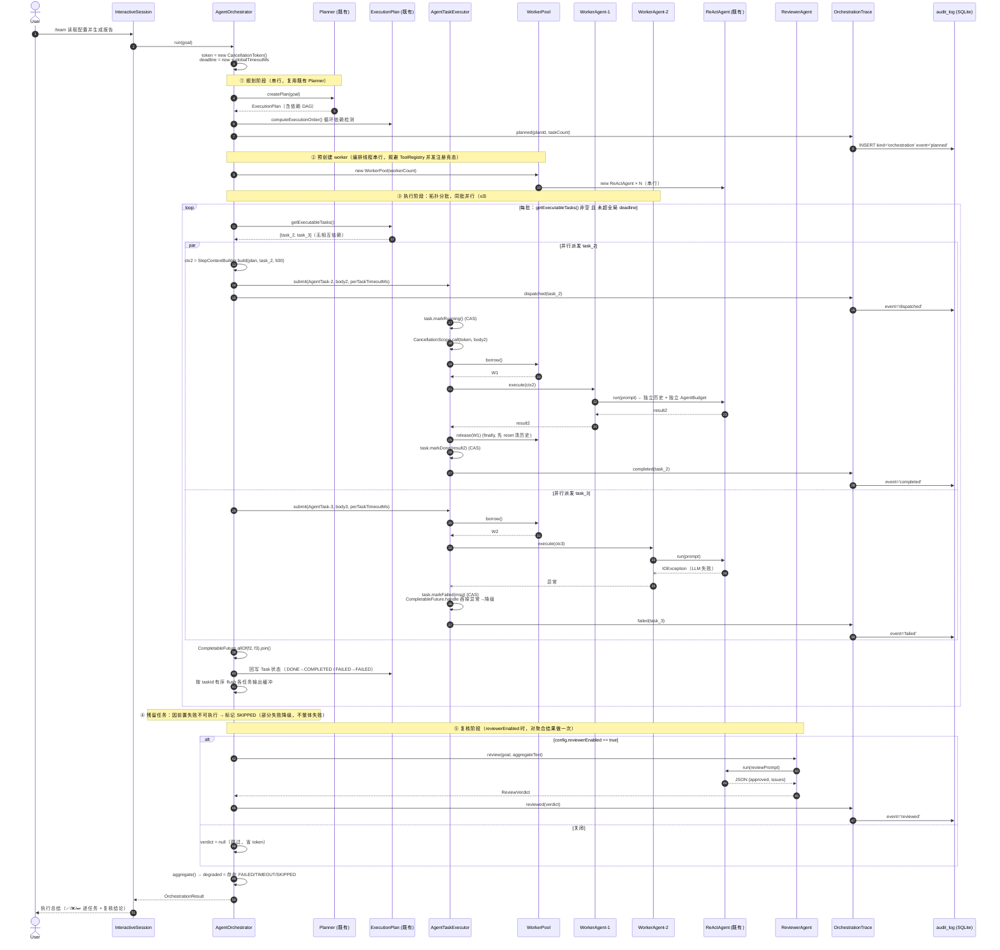
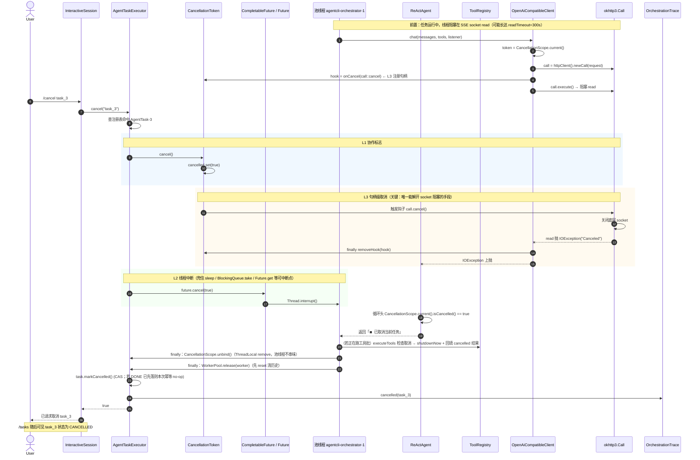
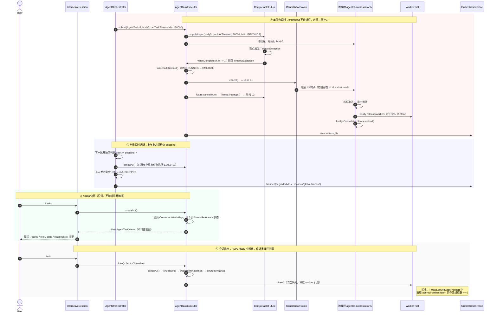
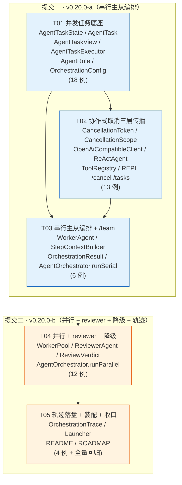

# AgentCLI v0.20.0 系统设计 · 并发编排底座 + 多 Agent 协作

> 架构师：高见远（Gao）　|　目标版本：v0.20.0（P0 最高优先级）
> 上游依据：`ROADMAP.md` §1.3 v0.20.0 章节（需求已确认，本文只做设计与任务分解）
> 现状基线：v0.19.0，全量 547 单测绿；Java 17 + Maven；运行时 5 依赖（OkHttp / Jackson / sqlite-jdbc / JLine / Logback）
>
> 文件命名说明：本文按主理人指定路径落 `docs/v020-design.md`。仓库既有约定为 `system_design_v0.18.0.md` /
> `class-diagram-v0.18.0.mermaid`，若需统一风格，合并时重命名为 `system_design_v0.20.0.md` 系列即可，内容不变。

---

## 0. 阅前摘要（TL;DR）

| 维度 | 结论 |
|---|---|
| 参考实现是否已有等价能力 | **已有**。`_reference` 有 `AgentOrchestrator`（planner/worker/reviewer + 并行批）、`SubAgent`、`AgentRole`、`CancellationToken/Context`、`runtime/task/*` 任务状态机、`/cancel` 命令 |
| 本版定位 | **移植 + 工程增强**（禁止写「首创 / 独有 / 参考缺失」） |
| 增强点（可讲、可测） | ① 状态机补 `TIMEOUT` + CAS 合法迁移校验　② 取消**真正传播到 OkHttp**（`Call.cancel` 句柄级）　③ 用显式绑定 ThreadLocal 修掉参考 `InheritableThreadLocal` 在线程池下的失效与泄漏　④ 单任务 + 全局双层超时与 `finally` 回收　⑤ 按 taskId 粒度取消 + `/tasks` 可观测　⑥ 编排轨迹落 `audit_log` 可回放 |
| 新增依赖 | **零**。仅 `java.util.concurrent` 标准库 |
| 拆分 | `v0.20.0-a`（T01–T03，串行主从）→ `v0.20.0-b`（T04–T05，并行 + reviewer + 降级 + 轨迹） |
| 新增用例 | ≈53 例（要求 ≥35），全部走 `StubLlmClient`，零真实网络 |

---

## 1. 与参考对比（`_reference` / `com.paicli`）

> **纪律说明**：本项目历史两次误判「参考没有」（`web_search`/`code_search`/SSRF 围栏），因此本节先做穷尽检索再下结论。
> 检索方式：`_reference/src/main/java` 全量 grep `ExecutorService|CompletableFuture|Cancellation|Orchestrator|TaskStatus|/cancel`。

### 1.1 参考**已有**的等价实现（逐文件核实）

| 参考文件 | 行数/体量 | 已实现的能力 |
|---|---|---|
| `_reference/com/paicli/agent/AgentOrchestrator.java` | 29 KB / 654 行 | 主从编排门面；planner 拆解 → `parsePlan` → 拓扑分批 `getExecutableSteps` → 单步串行 / 多步**并行**；`ExecutionStep` + `StepStatus{PENDING,RUNNING,COMPLETED,FAILED}`；worker 池化（`BlockingQueue<SubAgent>`）；每步独立 `ByteArrayOutputStream` 缓冲 + 按 step_id 有序 flush；reviewer 复核 + 最多 2 次重试；残留步骤跳过提示与部分完成汇总 |
| `_reference/com/paicli/agent/SubAgent.java` | 24 KB | 可配置角色的轻量 Agent，**独立对话历史**、共享 LlmClient/ToolRegistry |
| `_reference/com/paicli/agent/AgentRole.java` | — | `PLANNER / WORKER / REVIEWER` **三角色枚举，与本版需求完全一致** |
| `_reference/com/paicli/agent/AgentMessage.java` | — | 角色间消息载体（task / result / error） |
| `_reference/com/paicli/runtime/CancellationToken.java` | 15 行 | `AtomicBoolean` + `Thread.currentThread().isInterrupted()` 复合判定 |
| `_reference/com/paicli/runtime/CancellationContext.java` | 35 行 | 静态 `AtomicReference` + `InheritableThreadLocal` 的当前 token 持有器 |
| `_reference/com/paicli/runtime/task/TaskStatus.java` | — | `ENQUEUED / RUNNING / COMPLETED / FAILED / CANCELED` |
| `_reference/com/paicli/runtime/task/DurableTaskManager.java` | 13.5 KB | 持久化任务管理（含线程池） |
| `_reference/com/paicli/cli/Main.java` `runWithCancelSupport` | L1108–1160 | `token.cancel()` + `future.cancel(true)` + `executor.shutdownNow()`；ESC raw-mode 监听；`/cancel` 命令；`/team <任务>` 入口 |

**结论：并发取消、任务状态机、planner-worker-reviewer 三角色编排、同批并行，参考实现全部已有。**
本版**必须**定位为「移植 + 工程增强」。

> ⚠️ 文档一致性提醒：`ROADMAP.md` §2 B 组第 380/381 行把 Multi-Agent 编排与协作式取消标为「❌ 缺失」。
> 结合表头，该列语义是**「AgentCLI 当前状态」**而非「参考缺失」，与本节结论不冲突。但为防止后续误读成
> 「参考没有」，建议在该两行的「说明」列补一句「参考已有 `AgentOrchestrator`/`CancellationToken`，本版为移植增强」。
> —— 此项列入 §9 待明确事项。

### 1.2 参考**确实不足**、本版增强的六点（逐条可测、可讲）

| # | 参考现状（证据） | 本版增强 | 面试价值 |
|---|---|---|---|
| E1 | `StepStatus` 只有 4 态，**无 CANCELLED / TIMEOUT**；`runtime.TaskStatus` 有 CANCELED 但无 TIMEOUT；状态用 `volatile` 直接赋值 | 六态 `AgentTaskState`（含 `TIMEOUT`），`AtomicReference` + **CAS 合法迁移校验**，终态幂等 first-writer-wins | 并发下「DONE 被迟到的 CANCELLED 覆盖」是经典竞态，能讲清 CAS 与迁移表 |
| E2 | `AbstractOpenAiCompatibleClient` 用 `try (Response r = client.newCall(req).execute())`，**Call 句柄未持有**，取消只能靠中断——而中断在 JDK 13+ 虽能唤醒 socket read，却只抛出与网络故障无从区分的 `InterruptedIOException`，用户看到的是「调用失败」而非「已取消」 | `CancellationToken.onCancel(Runnable)` 钩子注册表；LLM 客户端发请求时注册 `call::cancel`，`finally` 注销；SSE 解析循环内每片轮询取消标志 | **「为什么不能只靠 Future.cancel」的标准答案落地物证**，本版最强单点。⚠️ 落地时**实测推翻**了「中断唤不醒 socket」的流行说法（详见 §2.3），把 L3 的价值从「唯一能中止」修正为「让中止语义可识别」——这个「动手实测推翻经验说法」的过程本身比原结论更有讲头 |
| E3 | `CancellationContext` 用 `InheritableThreadLocal`：只在**线程创建时**继承。`runBatchParallel` 每批新建线程池 → 首批凑巧可用，池线程复用后拿到**过期 token**，且线程存活期间 token 无法回收（泄漏） | 改用**普通 `ThreadLocal` + 任务执行期显式 bind/unbind**（`CancellationScope.call`），绑定发生在任务开始而非线程创建，`finally` 必 remove | ThreadLocal 与线程池的经典坑，能讲清「为什么 Inheritable 在池化场景是错的」 |
| E4 | **无任何超时**：`f.get()` 无限等；`executor.shutdownNow()` 在所有 `get()` 返回之后调用，此时已无可中断对象 | 单任务 `orTimeout` + 全局 deadline 双层；超时后**主动** `token.cancel()` + `future.cancel(true)` 才真回收（`orTimeout` 本身不会停底层线程——此坑写入共享知识） | 超时与资源回收，且能指出 `orTimeout` 的常见误用 |
| E5 | 全局单 token，`/cancel` 无参，**无法只取消某个任务**；无 `/tasks` 列表 | `AgentTaskExecutor` 内建 `ConcurrentHashMap` 任务注册表；`/cancel [taskId]`（无参=全部）、`/tasks` 快照 | 可观测性 + API 设计 |
| E6 | 编排过程**不落盘**，无法回放 | 派发/完成/失败/取消/超时写 `audit_log`（`kind="orchestration"`），`/audit` 可回放 | 复用 v0.10.0 装饰器与表，讲「旁路观测不侵入主流程」 |

### 1.3 简历口径（供后续 README / 简历同步，禁止越界）

> 「**移植**参考实现的 planner-worker-reviewer 多 Agent 编排并做**工程增强**：把任务生命周期从 4 态扩为含
> `TIMEOUT` 的六态状态机并用 CAS 保证并发迁移合法性；将协作式取消从『只置中断位』补齐为**三层传播**
> （volatile 标志轮询 → `Future.cancel(true)` 中断 → `okhttp3.Call.cancel()` 句柄级关闭 socket），
> 解决参考中 LLM 流式请求不响应取消的问题；修正参考 `InheritableThreadLocal` 在线程池下失效与泄漏的缺陷；
> 补充单任务 + 全局双层超时与 `finally` 资源回收；编排轨迹落 SQLite `audit_log` 支持 `/audit` 回放。」

---

## 2. 实现方案与框架选型

### 2.1 零依赖约束下的选型

**仅使用 `java.util.concurrent`**：`ExecutorService` / `CompletableFuture` / `AtomicReference` / `AtomicBoolean` /
`ConcurrentHashMap` / `CopyOnWriteArrayList` / `BlockingQueue` / `ThreadLocal`。
**不引入** Akka / Reactor / RxJava / Guava ListenableFuture 等任何编排框架。pom 依赖数保持 **5 运行时 + 2 测试** 不变。

### 2.2 线程池 vs CompletableFuture：**两者都用，职责正交**

| 组件 | 承担职责 | 理由 |
|---|---|---|
| `ExecutorService`（固定池、命名、daemon） | **资源边界**：并发上限 ≤3、线程命名 `agentcli-orchestrator-N`、生命周期与关闭回收 | 并发度必须可控（LLM 调用有 token 成本，见 §2.7）；命名线程让「线程泄漏检测」测试可断言；daemon 保证 REPL 退出不被挂住 |
| `CompletableFuture` | **编排语义**：`allOf` 批同步、`handle/exceptionally` 单任务降级、`orTimeout` 单任务超时 | 表达「部分失败降级」最自然——每个任务各自 `handle` 成一个 `TaskOutcome`，`allOf` 后不会因单点异常整批炸掉 |

**为什么不只用 `CompletableFuture`**：`supplyAsync` 不传 executor 时落到 `ForkJoinPool.commonPool()`——线程数与
CPU 核数绑定、不可命名、不可 shutdown，且我们的任务是**阻塞式 LLI/O**，会饿死公共池并影响 JVM 内其他并行流。
**约定：本项目所有 `CompletableFuture` 异步方法一律显式传入自建 executor。**

**为什么不只用 `ExecutorService.invokeAll`**：`invokeAll` 阻塞到**整批**完成（批尾延迟），且逐个 `future.get()`
用 try/catch 分流异常写起来很笨；`ToolRegistry.executeTools` 现有的 invokeAll 模式适合「同构短任务」，
而编排批是「异构长任务 + 需要逐任务降级」，`CompletableFuture.handle` 更贴合。两处粒度不同、各用其所，是设计而非不一致。

### 2.3 协作式取消：三层传播（本版核心）

```
L1 协作轮询   CancellationToken.isCancelled()  → volatile/AtomicBoolean
   检查点：ReAct 循环头、工具批次前、编排每批之间、SSE 每个 chunk
   作用：纯计算 / 循环密集段能及时退出；无副作用、最安全

L2 线程中断   Future.cancel(true) → Thread.interrupt()
   唤醒：sleep / wait / join / BlockingQueue.take / Future.get / 可中断通道
   JDK 13+ 亦可唤醒阻塞在 socket read 上的 OkHttp/Okio（NioSocketImpl）
   ⚠️ 局限：抛出的 InterruptedIOException 与真实网络故障无从区分

L3 句柄级取消 CancellationToken.onCancel(Runnable) 注册表
   okhttp3.Call.cancel()      → 关闭底层 socket，阻塞中的 read 抛 IOException("Canceled")
   Process.destroyForcibly()  → 终止 execute_command 派生的子进程
   作用：产出**可识别**的取消语义（"已取消" 而非 "调用失败"）
```

> **「为什么不能只靠 `Future.cancel(true)`」的完整答案**（⚠️ 本段已按实测修正，原表述有误，勿回改）：
> `Future.cancel(true)` 只是给目标线程置中断标志位。中断是一种**协作协议**——只有主动检查
> `isInterrupted()` 的代码，或阻塞在**可中断阻塞点**的线程才会响应。
>
> **原设计断言「OkHttp 的 socket read 不响应中断、会一直阻塞到 readTimeout(300s)」——实测不成立。**
> JDK 13 起 `NioSocketImpl` 取代了 `PlainSocketImpl`，实测（JDK 17 / Windows 11）对阻塞在慢 SSE 读取上的
> 线程 `interrupt()`，**百毫秒级**即抛出 `java.io.InterruptedIOException`。QA 用独立探针复现，耗时 116ms。
>
> **修正后的 L3 存在理由 —— 不是「唯一能中止」，而是「让中止语义可识别」**：
> 单靠 L2 拿到的 `InterruptedIOException(message="interrupted")` 与真实网络抖动**长得一模一样**，
> 上层只能报「LLM 调用失败」，用户无法判断是自己按了 `/cancel` 还是网断了；
> 唯有持有 `Call` 句柄显式 `cancel()`，才能确定性地转成 `CANCELLED_MESSAGE`，渲染出「已取消」。
> 对照实证见 `LlmCancellationTest#interruptAbortsReadButYieldsAnAmbiguousError`
> 与 `#cancelDuringSlowStreamAbortsImmediately`。
>
> 附带结论：这条修正**不影响任何代码结构**——L3 主路径（注册 `call::cancel` + finally 注销）与
> L1 每片轮询原样保留，取消行为一直是对的，错的只是「为什么需要它」的解释。

**Token 如何抵达 HTTP 层（不改接口签名）**

`LlmClient.chat(...)` 的签名被 8 个客户端实现 + `AuditLlmClient` 装饰器 + 大量既有测试引用，加参数会造成
大范围回归。采用**线程作用域环境值**传递：

```java
// 编排任务体内（池线程上）
CancellationScope.call(token, () -> worker.execute(prompt));   // finally 必 unbind

// OpenAiCompatibleClient.chat 内
CancellationToken token = CancellationScope.current();         // 可能为 null
Call call = httpClient().newCall(request.build());
Runnable hook = (token == null) ? null : token.onCancel(call::cancel);
try (Response response = call.execute()) { ... }
finally { if (hook != null) token.removeHook(hook); }          // 防止钩子列表随会话增长
```

**关键：用普通 `ThreadLocal` 而非 `InheritableThreadLocal`**（见 E3）。绑定时机是**任务开始执行时**，
不是线程创建时；`finally` 中 `remove()` 保证池线程不残留上一个任务的 token。

**零侵入保证**：`CancellationScope.current()` 返回 `null` 时，`ReActAgent`、`ToolRegistry`、LLM 客户端行为
**与 v0.19.0 完全一致**。既有 547 例测试不需要任何改动。

### 2.4 状态机实现

```
                 ┌──────────► CANCELLED  (取消发生在入队后、执行前)
                 │
 PENDING ──────► RUNNING ──┬──► DONE
                           ├──► FAILED
                           ├──► CANCELLED
                           └──► TIMEOUT

 终态 {DONE, FAILED, CANCELLED, TIMEOUT}：不可再迁移，重复 mark 为幂等 no-op（返回 false）
```

实现：`AgentTask` 内 `AtomicReference<AgentTaskState> state`，所有迁移走

```java
private boolean transition(AgentTaskState to) {
    while (true) {
        AgentTaskState cur = state.get();
        if (cur.isTerminal()) return false;          // 幂等：first-writer-wins
        if (!cur.canTransitionTo(to)) return false;  // 非法迁移拒绝（不抛异常，避免污染降级路径）
        if (state.compareAndSet(cur, to)) return true;
    }
}
```

**为什么 CAS 而不是 `synchronized` 或 `volatile` 直接赋值**：
- `volatile` 直接赋值（参考做法）无法阻止「超时线程写 TIMEOUT」与「worker 线程写 DONE」互相覆盖 —— 竞态可复现；
- `synchronized` 可行但粒度过重，且 `AgentTask` 会被 `/tasks` 高频只读快照，CAS 读路径无锁更合适；
- 迁移失败**返回 false 而不抛异常**：超时与正常完成天然会并发竞争，抛异常会把正常竞态变成噪声日志。

**为什么不复用 `plan.Task.TaskStatus`**：`plan.Task` 是**计划语义**（DAG 节点，字段落 `plan_tasks` 表，
参与 `/plan resume` 断点续跑）；`AgentTask` 是**执行语义**（并发生命周期、超时、取消）。
把 `TIMEOUT/CANCELLED` 塞进 `plan.Task.TaskStatus` 会污染已持久化的表 schema 与 `PlanStore` 恢复逻辑。
二者 **1:1 关联但不合并**，由 `AgentOrchestrator` 负责映射（`DONE→COMPLETED`，
`FAILED/TIMEOUT/CANCELLED→FAILED`，未执行→`SKIPPED`）。

### 2.5 超时与资源回收

| 层级 | 机制 | 回收动作 |
|---|---|---|
| 单任务 | `future.orTimeout(perTaskMs, MILLIS)` | ⚠️ `orTimeout` **只让 future 以 `TimeoutException` 完成，不会停止底层线程**。必须在 `whenComplete` 里补 `token.cancel()`（触发 L3 关 socket）+ `rawFuture.cancel(true)`（L2 中断），任务才真回收 |
| 全局 | 编排入口记 `deadlineNanos`；每批派发前检查剩余预算 | 预算不足 → 不再派发新批，已在跑的任务统一 `cancel`，走部分失败降级聚合 |
| 池 | `AgentTaskExecutor.close()` | `shutdown()` → `awaitTermination(5s)` → 未尽则 `shutdownNow()`；线程 daemon + 命名前缀 `agentcli-orchestrator-` |
| 会话 | `InteractiveSession.run()` 的 `finally` | 与既有 `lspManager.stopAll()` 并列，调用 `taskExecutor.close()` |

**线程泄漏检测测试**：编排前后各扫一次 `Thread.getAllStackTraces().keySet()`，
统计名字以 `agentcli-orchestrator-` 开头且 `isAlive()` 的线程数，`close()` 后必须归零。

### 2.6 共享可变状态的线程安全（逐项）

| 共享对象 | 现状风险 | 对策 |
|---|---|---|
| `ToolRegistry.tools` (`LinkedHashMap`) | **真实风险**：`ReActAgent` 构造函数里有 `toolRegistry.register(new SaveMemoryTool(...))`——若在并行任务体内 `new ReActAgent(...)`，多线程并发 `LinkedHashMap.put` 会破坏结构（死循环/丢数据） | ① **强约定：worker 一律在编排线程上串行预创建并池化复用，禁止在并行任务体内 new**；② 防御性加固：`tools` 改为 `Collections.synchronizedMap(new LinkedHashMap<>())`，`getToolDefinitions()` 内 `synchronized` 块做保序快照（保持插入序，不改对外行为） |
| `ToolRegistry` 执行路径 | `doExecuteTool` 只读 map + 调用无状态 Tool | 只读安全；`executeTools` 已用独立池 |
| `AuditLog` 并发写 | 每次 `store.connect()` 开短连接，URL 已带 `busy_timeout=5000` | 天然支持并发写，SQLite 侧串行化；沿用「写失败只告警不抛」旁路语义。`OrchestrationTrace` 遵循同一约定 |
| `ExecutionPlan.tasks` (`LinkedHashMap`) | 并行批内只**读**结构、只写 `Task` 内部 `volatile` 字段 | 安全。**约定：并行阶段禁止调用 `plan.addTask()`**（结构性修改必须在派发前完成） |
| `plan.Task` 字段 | 已全部 `volatile` | 满足可见性 |
| 并行流式输出 | 多线程写同一 `PrintStream` 会交错 | 沿用参考的成熟做法：每任务独立 `ByteArrayOutputStream`，批结束后按 taskId 有序 flush |

### 2.7 并发下的 token 成本控制

- 并发上限 **≤3**（`OrchestrationConfig.maxParallel`，可配），并发放大直接等比放大 token 消耗；
- 每个 worker 持有**独立 `AgentBudget`**（`AgentBudget.fromLlmClient`），单 worker 失控不拖垮整场；
- 依赖结果传给下游时**截断摘要**（默认 500 字符，对齐参考 `buildStepContext`），不传全文、不传对话历史；
- reviewer **可开关**（`reviewerEnabled`），默认对**聚合结果做一次**复核而非每步复核——参考是每步 review + 最多 2 次重试，
  token 成本约为 worker 的 1–3 倍；本版收敛为「一次终审」，成本可控且符合 ROADMAP「reviewer 对聚合结果做一次质量复核」。

### 2.8 设计模式落点（面试可直接引用）

| 模式 | 落点 |
|---|---|
| 门面 Facade | `AgentOrchestrator` 对 REPL 只暴露 `run(goal) : OrchestrationResult` |
| 策略 Strategy | `runSerial` / `runParallel` 两条执行策略，由 `OrchestrationConfig.maxParallel` 选择（=1 走串行） |
| 模板方法 Template Method | 沿用既有 `OpenAiCompatibleClient`；`WorkerAgent`/`ReviewerAgent` 共享「构造角色提示 → 调 ReAct → 解析产出」骨架 |
| 装饰器 Decorator | `AuditLlmClient`（既有）+ `OrchestrationTrace` 旁路观测 |
| 对象池 Object Pool | `WorkerPool`（`BlockingQueue<WorkerAgent>`），规避 ToolRegistry 并发注册竞争 |
| 空对象 Null Object | `CancellationScope.current()==null` 与 `OrchestrationTrace==null` 时零成本 no-op |

---

## 3. 文件列表（相对路径）

### 3.1 新建 —— 并发底座 `src/main/java/com/agentcli/agent/concurrent/`

| 文件 | 职责 | 批次 |
|---|---|---|
| `AgentTaskState.java` | 六态枚举 + `isTerminal()` + `canTransitionTo(AgentTaskState)` 迁移表 | a |
| `AgentTask.java` | 任务实体：id / name / role / `AtomicReference<AgentTaskState>` / result / error / createdAt / startedAt / finishedAt / token；CAS 迁移方法 | a |
| `AgentTaskView.java` | 只读快照 record，供 `/tasks` 渲染（避免把可变实体暴露给 CLI） | a |
| `CancellationToken.java` | `AtomicBoolean` + `CopyOnWriteArrayList<Runnable>` 钩子表；`cancel()` / `isCancelled()` / `onCancel(Runnable):Runnable` / `removeHook(Runnable)` / `throwIfCancelled()` | a |
| `CancellationScope.java` | 普通 `ThreadLocal<CancellationToken>`；`current()` / `call(token, Callable)` / `run(token, Runnable)`，`finally` 必 remove | a |
| `AgentTaskExecutor.java` | 固定池门面 + 任务注册表：`submit(AgentTask, Callable<String>, long timeoutMs) : CompletableFuture<String>`、`cancel(String taskId):boolean`、`cancelAll():int`、`snapshot():List<AgentTaskView>`、`close()`（`AutoCloseable`） | a |

### 3.2 新建 —— 多 Agent 编排 `src/main/java/com/agentcli/agent/orchestration/`

| 文件 | 职责 | 批次 |
|---|---|---|
| `AgentRole.java` | `PLANNER / WORKER / REVIEWER` 枚举（displayName + description），对齐参考语义 | a |
| `OrchestrationConfig.java` | record：`maxParallel(3)` / `workerCount(3)` / `perTaskTimeoutMs` / `globalTimeoutMs` / `reviewerEnabled` / `depResultPreviewChars(500)`；`defaults()` 静态工厂 | a |
| `WorkerAgent.java` | 包装独立 `ReActAgent`（独立历史 + 独立 `AgentBudget`）；`execute(String taskPrompt) : String`；`reset()` 清历史归还池 | a |
| `StepContextBuilder.java` | 上下文隔离：只用依赖任务的**结果摘要**拼 prompt，不共享历史 | a |
| `OrchestrationResult.java` | record：`status` / `List<AgentTaskView>` / `summaryText` / `degraded` / `reviewVerdict` | a |
| `AgentOrchestrator.java` | 门面：`run(String goal) : OrchestrationResult`；`runSerial`（a）+ `runParallel`（b）；plan→AgentTask 映射与状态回写 | a→b |
| `WorkerPool.java` | `BlockingQueue<WorkerAgent>`，编排线程串行预创建；`borrow(timeout)` / `release(w)` | b |
| `ReviewerAgent.java` | 对**聚合结果**做一次复核；`review(goal, aggregate) : ReviewVerdict`；解析失败**保守判不通过**（对齐参考 `parseReviewApproval`） | b |
| `ReviewVerdict.java` | record：`approved` / `issues` / `summary` | b |

### 3.3 新建 —— 轨迹观测 `src/main/java/com/agentcli/audit/`

| 文件 | 职责 | 批次 |
|---|---|---|
| `OrchestrationTrace.java` | 复用 `AuditLog` 与既有 `audit_log` 表；`dispatched/completed/failed/cancelled/timedOut/planned/reviewed`；`kind="orchestration"`；写失败只告警 | b |

### 3.4 修改（保持最小侵入）

| 文件 | 改动 | 批次 |
|---|---|---|
| `src/main/java/com/agentcli/llm/OpenAiCompatibleClient.java` | 持有 `Call` 句柄；向 `CancellationScope.current()` 注册 `call::cancel`，`finally` 注销；`parseStream` 每 chunk 轮询取消 → 抛 `IOException("已取消")` | a |
| `src/main/java/com/agentcli/agent/ReActAgent.java` | 循环头 + 工具批次前检查 `CancellationScope.current()`；取消则返回统一取消文案。token 为 null 时行为不变 | a |
| `src/main/java/com/agentcli/tool/ToolRegistry.java` | `tools` 改 `Collections.synchronizedMap(LinkedHashMap)` + `getToolDefinitions()` 保序快照；`executeTools` 批前/结果收集时检查取消，取消则 `shutdownNow` 并回填 cancelled 结果 | a |
| `src/main/java/com/agentcli/tool/ToolExecutionResult.java` | 新增 `cancelled(ToolInvocation)` 工厂（与既有 `completed/timedOut/failed` 同风格） | a |
| `src/main/java/com/agentcli/cli/CliCommandParser.java` | `CommandType` 增 `CANCEL / TASKS / TEAM`；对应 parse 分支（含无参形式）；`commandNames()` 补 `/cancel` `/tasks` `/team` | a |
| `src/main/java/com/agentcli/cli/InteractiveSession.java` | 持有 `AgentTaskExecutor`（懒加载）；`handleCommand` 增三个 case；`/team` 走编排；`printSessionHelp` 补三行；`run()` 的 `finally` 补 `taskExecutor.close()` | a→b |
| `src/main/java/com/agentcli/cli/Launcher.java` | `auditLog != null` 时构造 `OrchestrationTrace` 并注入 `InteractiveSession`（沿用既有 auditLog 装配点 L84–L124） | b |

### 3.5 新建 —— 测试 `src/test/java/com/agentcli/`

| 文件 | 用例数 | 覆盖 | 批次 |
|---|---|---|---|
| `agent/concurrent/AgentTaskStateMachineTest.java` | 8 | 合法/非法迁移、终态幂等、并发 CAS（DONE vs TIMEOUT 只有一个生效）、时间戳 | a |
| `agent/concurrent/AgentTaskExecutorTest.java` | 10 | 并发提交、`cancel(taskId)` 精确命中、`cancelAll`、单任务超时→TIMEOUT、`close()` 回收、**线程泄漏检测**、`snapshot` 一致性、拒绝提交 after close | a |
| `agent/concurrent/CancellationPropagationTest.java` | 6 | 钩子触发顺序、`ThreadLocal` 池化不串味/不泄漏、ReActAgent 循环内取消、ToolRegistry 批次取消、token=null 零侵入回归 | a |
| `llm/LlmCancellationTest.java` | 3 | `MockWebServer` 造慢 SSE：`Call.cancel()` 立即返回且产出可识别的「已取消」语义；对照组 `interrupt()` 在 JDK 13+ 也能唤醒 socket read，但只抛出与网络故障无从区分的 `InterruptedIOException`（**E2 的实证**，详见 §2.3）；钩子 finally 注销 | a |
| `agent/orchestration/AgentOrchestratorSerialTest.java` | 6 | Stub LLM 确定性计划 → 串行执行、依赖顺序、上下文隔离断言（下游 prompt 含依赖摘要且**不含**上游对话历史）、失败中止 | a |
| `agent/orchestration/AgentOrchestratorParallelTest.java` | 8 | 同批并行且并发度 ≤3（CountDownLatch 观测峰值）、部分失败降级聚合、reviewer 开关、全局超时、有序输出 flush | b |
| `agent/orchestration/ReviewerAgentTest.java` | 4 | JSON 解析、非 JSON 关键词兜底、空输出保守判不通过、issues 提取 | b |
| `audit/OrchestrationTraceTest.java` | 4 | 五类事件落盘、`kind="orchestration"` 可被 `/audit` 查出、并发写、store 不可用时静默降级 | b |
| `cli/CliCommandParserTest.java`（增量） | 2 | `/cancel` `/cancel task_1` `/tasks` `/team x` 解析 | a |
| `cli/InteractiveSessionTest.java`（增量） | 2 | `/tasks` 空列表文案、`/cancel` 无运行任务文案 | a |
| **合计** | **≈53** | 需求要求 ≥35 ✅ | |

---

## 4. 数据结构与接口（类图）

> 完整源文件：`docs/v020-class-diagram.mermaid`

```mermaid
classDiagram
    direction LR

    %% ---------- 并发底座 agent.concurrent ----------
    class AgentTaskState {
        <<enumeration>>
        PENDING
        RUNNING
        DONE
        FAILED
        CANCELLED
        TIMEOUT
        +boolean isTerminal()
        +boolean canTransitionTo(AgentTaskState to)
    }

    class AgentTask {
        -String id
        -String name
        -AgentRole role
        -AtomicReference~AgentTaskState~ state
        -volatile String result
        -volatile String error
        -long createdAt
        -volatile long startedAt
        -volatile long finishedAt
        -CancellationToken token
        +AgentTask(String id, String name, AgentRole role, CancellationToken token)
        +AgentTaskState state()
        +boolean markRunning()
        +boolean markDone(String result)
        +boolean markFailed(String error)
        +boolean markCancelled()
        +boolean markTimeout()
        +long durationMs()
        +AgentTaskView toView()
        -boolean transition(AgentTaskState to)
    }

    class AgentTaskView {
        <<record>>
        +String id
        +String name
        +AgentRole role
        +AgentTaskState state
        +long durationMs
        +String errorPreview
        +String summaryLine()
    }

    class CancellationToken {
        -AtomicBoolean cancelled
        -CopyOnWriteArrayList~Runnable~ hooks
        +void cancel()
        +boolean isCancelled()
        +Runnable onCancel(Runnable hook)
        +void removeHook(Runnable hook)
        +void throwIfCancelled() throws CancelledException
    }

    class CancellationScope {
        <<utility>>
        -ThreadLocal~CancellationToken~ CURRENT
        +CancellationToken current()$
        +T call(CancellationToken t, Callable~T~ body)$
        +void run(CancellationToken t, Runnable body)$
    }

    class AgentTaskExecutor {
        <<facade>>
        -ExecutorService pool
        -ConcurrentHashMap~String,AgentTask~ tasks
        -ConcurrentHashMap~String,CompletableFuture~ futures
        -volatile boolean closed
        +AgentTaskExecutor(int maxParallel)
        +CompletableFuture~String~ submit(AgentTask task, Callable~String~ body, long timeoutMs)
        +boolean cancel(String taskId)
        +int cancelAll()
        +List~AgentTaskView~ snapshot()
        +void close()
    }

    %% ---------- 编排 agent.orchestration ----------
    class AgentRole {
        <<enumeration>>
        PLANNER
        WORKER
        REVIEWER
    }

    class OrchestrationConfig {
        <<record>>
        +int maxParallel
        +int workerCount
        +long perTaskTimeoutMs
        +long globalTimeoutMs
        +boolean reviewerEnabled
        +int depResultPreviewChars
        +OrchestrationConfig defaults()$
    }

    class AgentOrchestrator {
        <<facade>>
        -Planner planner
        -WorkerPool workerPool
        -ReviewerAgent reviewer
        -AgentTaskExecutor executor
        -OrchestrationTrace trace
        -OrchestrationConfig config
        -PrintStream out
        +AgentOrchestrator(LlmClient llm, ToolRegistry tools, OrchestrationConfig cfg)
        +void setTrace(OrchestrationTrace trace)
        +OrchestrationResult run(String goal)
        -OrchestrationResult runSerial(ExecutionPlan plan, CancellationToken token)
        -OrchestrationResult runParallel(ExecutionPlan plan, CancellationToken token)
        -OrchestrationResult aggregate(ExecutionPlan plan, List~AgentTask~ tasks)
    }

    class WorkerAgent {
        -String name
        -ReActAgent delegate
        +WorkerAgent(String name, LlmClient llm, ToolRegistry tools)
        +String execute(String taskPrompt)
        +void reset()
    }

    class WorkerPool {
        -BlockingQueue~WorkerAgent~ idle
        +WorkerPool(int size, LlmClient llm, ToolRegistry tools)
        +WorkerAgent borrow(long timeoutMs)
        +void release(WorkerAgent w)
    }

    class ReviewerAgent {
        -ReActAgent delegate
        +ReviewVerdict review(String goal, String aggregate)
        +boolean parseApproval(String raw)
        +String parseIssues(String raw)
    }

    class ReviewVerdict {
        <<record>>
        +boolean approved
        +String issues
        +String summary
    }

    class StepContextBuilder {
        <<utility>>
        +String build(ExecutionPlan plan, Task task, int previewChars)$
    }

    class OrchestrationResult {
        <<record>>
        +boolean degraded
        +List~AgentTaskView~ tasks
        +String summaryText
        +ReviewVerdict reviewVerdict
    }

    %% ---------- 复用的既有组件 ----------
    class ReActAgent {
        <<existing>>
        +String run(String userInput)
        +void clearHistory()
        +ToolRegistry getToolRegistry()
    }

    class Planner {
        <<existing>>
        +ExecutionPlan createPlan(String goal)
    }

    class ExecutionPlan {
        <<existing>>
        +List~Task~ getExecutableTasks()
        +List~String~ getExecutionOrder()
        +boolean computeExecutionOrder()
    }

    class Task {
        <<existing>>
        +TaskStatus getStatus()
        +void markCompleted(String result)
        +void markFailed(String error)
    }

    class ToolRegistry {
        <<existing / modified>>
        -Map~String,Tool~ tools
        +List~ToolExecutionResult~ executeTools(List~ToolInvocation~ inv)
        +List~Tool~ getToolDefinitions()
    }

    class OpenAiCompatibleClient {
        <<existing / modified>>
        +ChatResponse chat(List messages, List tools, StreamListener l)
    }

    class OrchestrationTrace {
        +OrchestrationTrace(AuditLog auditLog)
        +void planned(String planId, int taskCount)
        +void dispatched(String planId, AgentTask t)
        +void completed(String planId, AgentTask t)
        +void failed(String planId, AgentTask t)
        +void cancelled(String planId, AgentTask t)
        +void timedOut(String planId, AgentTask t)
        +void reviewed(String planId, ReviewVerdict v)
    }

    class AuditLog {
        <<existing>>
        +void recordLlm(...)
        +List~AuditEntry~ query(int limit, String kind)
    }

    class InteractiveSession {
        <<existing / modified>>
        -AgentTaskExecutor taskExecutor
        -OrchestrationTrace trace
        +boolean handleCommand(ParsedCommand c, PrintStream out)
        -void handleTeam(String goal, PrintStream out)
        -void handleCancel(String taskId, PrintStream out)
        -void handleTasks(PrintStream out)
    }

    %% ---------- 关系 ----------
    AgentTask --> AgentTaskState : 持有 AtomicReference
    AgentTask --> CancellationToken : 每任务一个
    AgentTask ..> AgentTaskView : 生成只读快照
    AgentTask --> AgentRole
    AgentTaskExecutor "1" *-- "0..*" AgentTask : 注册表
    AgentTaskExecutor ..> CancellationScope : 任务体内 bind/unbind
    CancellationScope ..> CancellationToken : ThreadLocal 承载

    AgentOrchestrator --> AgentTaskExecutor
    AgentOrchestrator --> WorkerPool
    AgentOrchestrator --> ReviewerAgent
    AgentOrchestrator --> Planner : 复用既有
    AgentOrchestrator --> OrchestrationConfig
    AgentOrchestrator --> OrchestrationTrace : 可为 null
    AgentOrchestrator ..> ExecutionPlan
    AgentOrchestrator ..> StepContextBuilder
    AgentOrchestrator ..> OrchestrationResult : 产出
    WorkerPool "1" *-- "N" WorkerAgent
    WorkerAgent --> ReActAgent : 委托（独立历史/预算）
    ReviewerAgent --> ReActAgent
    ReviewerAgent ..> ReviewVerdict
    ExecutionPlan "1" *-- "N" Task

    ReActAgent --> ToolRegistry
    ReActAgent ..> CancellationScope : 循环头轮询
    ToolRegistry ..> CancellationScope : 批次前轮询
    OpenAiCompatibleClient ..> CancellationScope : 注册 Call.cancel 钩子
    OrchestrationTrace --> AuditLog : 复用 audit_log 表

    InteractiveSession --> AgentTaskExecutor
    InteractiveSession ..> AgentOrchestrator : /team
    InteractiveSession --> OrchestrationTrace
```



### 关键方法签名速查

```java
// agent/concurrent/CancellationToken.java
public Runnable onCancel(Runnable hook);   // 返回句柄用于 removeHook；若已取消则立即执行 hook
public void removeHook(Runnable handle);   // 必须在 finally 调用，防止长会话钩子列表无限增长

// agent/concurrent/CancellationScope.java
public static <T> T call(CancellationToken token, Callable<T> body) throws Exception;
public static CancellationToken current();  // 可能返回 null → 调用方零侵入

// agent/concurrent/AgentTaskExecutor.java
public CompletableFuture<String> submit(AgentTask task, Callable<String> body, long timeoutMs);
public boolean cancel(String taskId);       // token.cancel() + future.cancel(true)
public List<AgentTaskView> snapshot();      // /tasks 数据源，只读

// agent/orchestration/AgentOrchestrator.java
public OrchestrationResult run(String goal);  // 唯一对外入口（门面）
```

---

## 5. 程序调用流程（时序图）

> 完整源文件：`docs/v020-sequence-diagram.mermaid`

### 5.1 一次并行编排（planner → 分批 → worker 并行 → reviewer → 聚合）



### 5.2 `/cancel` 中断传播链路（三层）



### 5.3 超时回收 + 全局熔断 + `/tasks` 快照 + 会话退出无泄漏

> **本图对应验收项**：超时回收、线程泄漏检测。核心结论是 **`orTimeout` 只会完成 future，不会停下底层线程** —— 必须补 `token.cancel()`（L1）与 `future.cancel(true)`（L2/L3），否则线程会一直挂到 `readTimeout=300s`，池被占满，表现为"超时了但后续任务排不进来"。



---

## 6. 任务列表（有序，含依赖，按实现顺序）

> 拆两次提交：**`v0.20.0-a` = T01→T02→T03**（串行主从可用）；**`v0.20.0-b` = T04→T05**（并行 + reviewer + 降级 + 轨迹）。
> 每个任务自带测试，**任务完成的定义 = 该任务涉及的测试全绿 + 全量回归 547 例不退化**。

### 提交一：`v0.20.0-a` —— 串行主从编排

---

#### **T01 · 并发任务底座（状态机 + 线程池执行器）**
- **优先级**：P0　**依赖**：无　**预估**：1.5 人日
- **新建**
  - `src/main/java/com/agentcli/agent/concurrent/AgentTaskState.java`
  - `src/main/java/com/agentcli/agent/concurrent/AgentTask.java`
  - `src/main/java/com/agentcli/agent/concurrent/AgentTaskView.java`
  - `src/main/java/com/agentcli/agent/concurrent/AgentTaskExecutor.java`
  - `src/main/java/com/agentcli/agent/orchestration/AgentRole.java`
  - `src/main/java/com/agentcli/agent/orchestration/OrchestrationConfig.java`
  - `src/test/java/com/agentcli/agent/concurrent/AgentTaskStateMachineTest.java`（8 例）
  - `src/test/java/com/agentcli/agent/concurrent/AgentTaskExecutorTest.java`（10 例）
- **要点**：六态 + CAS 迁移表 + 终态幂等；固定池命名 `agentcli-orchestrator-%d` + daemon；
  `submit` 内 `orTimeout` **并在 `whenComplete` 补 `token.cancel()` + `cancel(true)`**；
  `close()` = `shutdown → awaitTermination(5s) → shutdownNow`；线程泄漏检测用例。
- **验收**：18 例绿；`close()` 后 `agentcli-orchestrator-` 前缀存活线程数 = 0。

---

#### **T02 · 协作式取消三层传播（含 REPL `/cancel` `/tasks`）**
- **优先级**：P0　**依赖**：T01　**预估**：1.5 人日
- **新建**
  - `src/main/java/com/agentcli/agent/concurrent/CancellationToken.java`
  - `src/main/java/com/agentcli/agent/concurrent/CancellationScope.java`
  - `src/test/java/com/agentcli/agent/concurrent/CancellationPropagationTest.java`（6 例）
  - `src/test/java/com/agentcli/llm/LlmCancellationTest.java`（3 例，用既有 `mockwebserver` 测试依赖）
- **修改**
  - `src/main/java/com/agentcli/llm/OpenAiCompatibleClient.java`（持 Call + 注册/注销钩子 + SSE 每片轮询）
  - `src/main/java/com/agentcli/agent/ReActAgent.java`（循环头 + 工具批前检查）
  - `src/main/java/com/agentcli/tool/ToolRegistry.java`（`synchronizedMap` + 批次取消检查）
  - `src/main/java/com/agentcli/tool/ToolExecutionResult.java`（新增 `cancelled` 工厂）
  - `src/main/java/com/agentcli/cli/CliCommandParser.java`（`CANCEL` / `TASKS` + 补全目录）
  - `src/main/java/com/agentcli/cli/InteractiveSession.java`（两个 case + 帮助 + `finally` close）
  - `src/test/java/com/agentcli/cli/CliCommandParserTest.java`（+2 例）
  - `src/test/java/com/agentcli/cli/InteractiveSessionTest.java`（+2 例）
- **要点**：**普通 `ThreadLocal`，禁用 `InheritableThreadLocal`**；`finally` 必 `remove()` 与 `removeHook()`；
  `current()==null` 时全链路零侵入（既有 547 例不得改动）。
- **验收**：13 例绿；`LlmCancellationTest` 必须证明「`interrupt` 在 JDK 13+ 可唤醒 socket read 但只给出与网络故障无法区分的 `InterruptedIOException`，`Call.cancel` 则确定性产出可识别的「已取消」语义」（详见 §2.3 的实测结论，原「interrupt 唤不醒 socket」表述已作废）。

---

#### **T03 · 串行主从编排 + `/team` 入口**
- **优先级**：P0　**依赖**：T01, T02　**预估**：1.5 人日
- **新建**
  - `src/main/java/com/agentcli/agent/orchestration/WorkerAgent.java`
  - `src/main/java/com/agentcli/agent/orchestration/StepContextBuilder.java`
  - `src/main/java/com/agentcli/agent/orchestration/OrchestrationResult.java`
  - `src/main/java/com/agentcli/agent/orchestration/AgentOrchestrator.java`（**本任务只实现 `runSerial`**）
  - `src/test/java/com/agentcli/agent/orchestration/AgentOrchestratorSerialTest.java`（6 例）
- **修改**
  - `src/main/java/com/agentcli/cli/CliCommandParser.java`（`TEAM`）
  - `src/main/java/com/agentcli/cli/InteractiveSession.java`（`/team` case + 帮助行）
- **要点**：复用既有 `Planner` / `ExecutionPlan`（**不重写 DAG 与拓扑排序**）；
  worker 独立 `ReActAgent`（独立历史 + 独立 `AgentBudget`）；
  上下文隔离断言：下游 prompt 含依赖**结果摘要**、**不含**上游对话历史。
- **验收**：6 例绿。**`v0.20.0-a` 可提交**：`/team <目标>` 端到端串行跑通，`/cancel` 可中断。

---

### 提交二：`v0.20.0-b` —— 并行 + reviewer + 降级 + 轨迹

---

#### **T04 · 同批并行执行 + reviewer + 部分失败降级**
- **优先级**：P0　**依赖**：T03　**预估**：2 人日
- **新建**
  - `src/main/java/com/agentcli/agent/orchestration/WorkerPool.java`
  - `src/main/java/com/agentcli/agent/orchestration/ReviewerAgent.java`
  - `src/main/java/com/agentcli/agent/orchestration/ReviewVerdict.java`
  - `src/test/java/com/agentcli/agent/orchestration/AgentOrchestratorParallelTest.java`（8 例）
  - `src/test/java/com/agentcli/agent/orchestration/ReviewerAgentTest.java`（4 例）
- **修改**
  - `src/main/java/com/agentcli/agent/orchestration/AgentOrchestrator.java`（新增 `runParallel`；`maxParallel==1` 走串行——策略模式）
- **要点**：`CompletableFuture.allOf` 批同步 + 逐任务 `handle` 降级；并发度 ≤3 用 `CountDownLatch` 观测峰值断言；
  worker **预创建 + 池化借还**（禁止并行体内 `new ReActAgent`）；
  每任务独立 `ByteArrayOutputStream`，批末按 taskId 有序 flush；
  reviewer 对**聚合结果做一次**复核，解析失败**保守判不通过**；全局 deadline 检查。
- **验收**：12 例绿；并行用例可稳定复现「峰值并发 ≤3」与「1 失败 2 成功 → 降级聚合而非整体失败」。

---

#### **T05 · 编排轨迹落盘 + 启动装配 + 收口回归**
- **优先级**：P0　**依赖**：T04　**预估**：1 人日
- **新建**
  - `src/main/java/com/agentcli/audit/OrchestrationTrace.java`
  - `src/test/java/com/agentcli/audit/OrchestrationTraceTest.java`（4 例）
- **修改**
  - `src/main/java/com/agentcli/agent/orchestration/AgentOrchestrator.java`（注入 trace，七个事件埋点）
  - `src/main/java/com/agentcli/cli/Launcher.java`（`auditLog != null` 时构造并注入，沿用 L84–L124 装配点）
  - `src/main/java/com/agentcli/cli/InteractiveSession.java`（接收 trace 并下传编排器；`printSessionHelp` 收口）
  - `README.md` / `ROADMAP.md`（v0.20.0 标记完成；§2 B 组补「参考已有，本版为移植增强」口径）
- **要点**：`kind="orchestration"`，`/audit` 可直接回放（`AuditLog.query(limit, "orchestration")` 已支持按 kind 过滤）；
  trace 为 `null` 时零成本 no-op；写失败只告警不抛（对齐 `AuditLog` 既有旁路语义）。
- **验收**：4 例绿；**全量回归 ≥600 例绿**（547 既有 + ≈53 新增）；`mvn package` fat-jar 冒烟通过；CI 三重扫描过。

---

### 6.1 任务依赖图



> 依赖链说明：T02 与 T03 都依赖 T01，但 T03 还需要 T02 的 `CancellationScope`（worker 执行体要绑定 token），
> 故为线性链。T04/T05 严格在 `v0.20.0-a` 提交并回归绿之后开始，保证任一时点主干可编译可运行。

---

## 7. 依赖包列表

**零新增依赖。仅使用 Java 17 标准库。**

| 用途 | 标准库 API |
|---|---|
| 线程池与生命周期 | `java.util.concurrent.ExecutorService` / `Executors.newFixedThreadPool(int, ThreadFactory)` / `TimeUnit` |
| 异步编排 | `java.util.concurrent.CompletableFuture`（`supplyAsync(supplier, executor)` / `allOf` / `handle` / `orTimeout` / `whenComplete`） |
| 原子状态 | `java.util.concurrent.atomic.AtomicReference` / `AtomicBoolean` |
| 并发容器 | `java.util.concurrent.ConcurrentHashMap` / `CopyOnWriteArrayList` / `LinkedBlockingQueue` |
| 线程作用域 | `java.lang.ThreadLocal`（**明确不用 `InheritableThreadLocal`**） |
| 取消/中断 | `Future.cancel(boolean)` / `Thread.interrupt()` / `Thread.currentThread().isInterrupted()` |
| 同步包装 | `java.util.Collections.synchronizedMap` |

现有 5 个运行时依赖中，**仅 OkHttp 被本版触及**（`okhttp3.Call#cancel()`，OkHttp 既有公开 API，非新增依赖）。
`pom.xml` **不作任何修改**，依赖口径保持「5 运行时 + 2 测试」。

---

## 8. 共享知识（跨文件约定 —— 工程师必读）

### 8.1 线程安全铁律

1. **禁止在并行任务体内 `new ReActAgent(...)`**。`ReActAgent` 构造函数会执行
   `toolRegistry.register(new SaveMemoryTool(...))`，对共享 `ToolRegistry` 的 map 做写操作。
   所有 worker **必须**在编排线程上串行预创建，并通过 `WorkerPool` 借还复用。
2. `ToolRegistry.tools` 改为 `Collections.synchronizedMap(new LinkedHashMap<>())`；
   `getToolDefinitions()` 内用 `synchronized (tools) { ... }` 做**保序**快照后再流式转换
   （`synchronizedMap` 的迭代**不自动加锁**，必须手动同步块，否则仍会 `ConcurrentModificationException`）。
3. **并行阶段禁止 `ExecutionPlan.addTask()`**。所有结构性修改必须在派发前完成；
   并行期间只允许写 `Task` 内部已 `volatile` 的字段。
4. 并行流式输出**必须**每任务独立 `ByteArrayOutputStream`，批末按 taskId 有序 flush；
   **禁止**多线程直写同一 `PrintStream`。
5. 审计并发写安全：`AuditLog` 每次 `store.connect()` 开短连接，URL 已含 `busy_timeout=5000`，SQLite 侧串行化。
   `OrchestrationTrace` 沿用同一模式，**写失败只 `System.err` 告警、绝不抛出中断主流程**。

### 8.2 取消标志的读取契约

| 位置 | 检查方式 | 取消时行为 |
|---|---|---|
| `ReActAgent.run` 循环头 | `CancellationScope.current()` 非 null 且 `isCancelled()` | 返回统一文案 `"⏹️ 已取消当前任务。"` |
| `ReActAgent` 工具批次前 | 同上 | 同上，不再派发工具 |
| `ToolRegistry.executeTools` 批前 / 收集结果时 | 同上 | `executor.shutdownNow()`，未完成项回填 `ToolExecutionResult.cancelled(...)` |
| `OpenAiCompatibleClient.chat` 发起前 | 同上 | 直接抛 `IOException("已取消")`，不发请求 |
| `OpenAiCompatibleClient.parseStream` 每个 SSE chunk | 同上 | 跳出循环并抛 `IOException("已取消")` |
| `OpenAiCompatibleClient` 请求期间 | `token.onCancel(call::cancel)` 钩子 | **socket 被关闭**，阻塞 read 立即抛 `IOException("Canceled")` |
| `AgentOrchestrator` 每批之间 | 同上 + 全局 deadline | 停止派发新批，已跑任务统一 cancel，走降级聚合 |

**`null` 语义**：`CancellationScope.current()` 返回 `null` 表示「不在可取消作用域内」，
所有调用点必须**按 v0.19.0 原行为执行**。这是既有 547 例零改动的前提。

**钩子生命周期**：`onCancel` 返回句柄，调用方**必须**在 `finally` 中 `removeHook(handle)`。
一次 `/team` 编排可能触发数十次 LLM 调用，不注销会让 `CopyOnWriteArrayList` 无限增长
（且 CopyOnWrite 的写成本随长度线性上升）。

### 8.3 Stub LLM 测试约定

- 统一复用既有 `src/test/java/com/agentcli/testsupport/StubLlmClient.java`（`enqueue(ChatResponse)` /
  `enqueueFailure(IOException)` / `chatCalls()`），**不要新造 Stub**。
- **并发测试的确定性**：`StubLlmClient.scripted` 是 `ArrayList` + `chatCalls++`，**非线程安全**。
  并行用例若让多个 worker 共享同一实例会脏读。约定二选一：
  - **推荐**：每个 `WorkerAgent` 注入**独立** `StubLlmClient` 实例（并行编排测试走此路）；
  - 或在测试内包一层 `synchronized` 代理。
  > 建议由工程师在 T04 顺手补一个 `ConcurrentStubLlmClient`（测试域，`synchronizedList` + `AtomicInteger`），
  > 但**不得修改** `StubLlmClient` 既有语义以免影响既存用例。
- 编排测试**不依赖真实网络**；唯一用 `MockWebServer` 的是 `LlmCancellationTest`（验证 `Call.cancel`），
  该依赖已在 `pom.xml` test scope 中，无需新增。
- 并发度断言用 `CountDownLatch` + `AtomicInteger` 峰值计数，**禁止用 `Thread.sleep` 做时序假设**（CI 上必 flaky）。

### 8.4 轨迹落盘字段约定（`audit_log` 表，schema 不变）

| 列 | 取值 |
|---|---|
| `kind` | 固定 `"orchestration"` |
| `target` | `taskId`（计划级事件用 `planId`） |
| `tokens` | 本任务累计 token（不可得时 `null`） |
| `latency_ms` | `AgentTask.durationMs()`（未结束时 `null`） |
| `detail_json` | `{"event":"...","plan_id":"...","task_id":"...","role":"WORKER","state":"DONE","error":"...","attempt":1}` |

`event` 枚举：`planned` / `dispatched` / `completed` / `failed` / `cancelled` / `timedout` / `reviewed`。
`/audit` 无需改造即可回放（`AuditLog.query(int, String kind)` 已支持 kind 过滤）。

### 8.5 REPL 命令返回结构

| 命令 | 无参行为 | 带参行为 | 输出格式 |
|---|---|---|---|
| `/tasks` | 列出**本会话全部**任务快照 | — | `task_1  [DONE]      worker  1234ms  读取配置文件`；空时 `暂无编排任务。` |
| `/cancel` | 取消**所有**运行中任务，回显取消条数 | `/cancel task_3` 精确取消 | 命中 `已请求取消 task_3。`；未命中 `未找到运行中的任务: task_3` |
| `/team <目标>` | 打印用法提示 | 执行多 Agent 编排 | 阶段标题 + 逐任务 ✅/❌/⏭ + 复核结论 |

- 所有命令走 `CliCommandParser.parse` → `CommandType` → `InteractiveSession.handleCommand` 的既有 switch 模式；
- **无参形式必须返回对应 `CommandType`（payload=null）而非 `NONE`**，否则 `/tasks` 会掉进自然语言轮被当成提问发给模型
  —— 这是 v0.18.0 RAG 三命令踩过的坑，源码注释里已有记录（`CliCommandParser` L155–157）。
- 三个命令需同步加入 `CliCommandParser.commandNames()`（Tab 补全目录）与 `printSessionHelp`。

### 8.6 编码风格（与现有代码一致）

- **中文 Javadoc**，类级注释说明「职责 + 关键设计取舍」，与 `ToolRegistry` / `SqliteStore` 风格一致；
- ⚠️ **引用参考实现时只能写路径形式 `_reference/com/paicli/agent/AgentOrchestrator.java`（斜杠），
  绝不能写包名形式 `com.paicli.xxx`（点号）** —— `src/test/java/com/agentcli/quality/SourceQualityScanTest.java`
  会扫描 `src/**` 下所有 `.java/.md/.xml/.yml/.properties`，命中 `com.paicli` 直接测试失败。既有 `plan/Task.java`
  的注释即为正确范例；
- 日志用 `org.slf4j.Logger`（`LoggerFactory.getLogger(X.class)`），面向用户的文案用 `PrintStream out` 输出；
- 用户可见错误文案统一走 `com.agentcli.common.UserFacingErrors`；
- 记录类优先用 `record`（对齐 `AuditEntry` / `ToolExecutionResult` / `ParsedCommand` 风格）。

---

## 9. 待明确事项（需主理人/用户拍板）

| # | 事项 | 背景 | 建议默认值 |
|---|---|---|---|
| Q1 | **ROADMAP 口径修订** | §2 B 组 L380/381 把 Multi-Agent 与协作式取消标为「❌ 缺失」。按表头语义指的是 AgentCLI 现状，但极易被误读成「参考缺失」，与本文 §1.1 实证冲突 | 在这两行「说明」列补「参考已有 `AgentOrchestrator`/`CancellationToken`，本版为**移植 + 工程增强**」，并同步简历口径为 §1.3 版本 |
| Q2 | **`/team` 是否需要 ESC 键取消** | 参考在 `Main.runWithCancelSupport` 用 JLine raw mode 监听 ESC。本版 REPL 是阻塞式 `input.readLine()`，编排跑起来时**用户无法输入 `/cancel`** —— 这会让 `/cancel` 在交互路径上形同虚设 | 建议 v0.20.0 先做**非阻塞输入监听**（JLine 已在依赖内，参考 `runWithCancelSupport` 的 150ms 轮询 + `future.get(timeout)` 模式）。若判定超范围，则 `/cancel` 仅覆盖「后台任务 + 编程接口 + 测试」场景，需在 README 明确说明限制 |
| Q3 | **单任务 / 全局超时默认值** | ROADMAP 未给具体数值。SSE `readTimeout` 默认 300s、`callTimeout` 600s | 建议单任务 **300s**、全局 **900s**，均可用系统属性覆盖（`agentcli.orchestration.task.timeout.seconds` / `agentcli.orchestration.global.timeout.seconds`），与既有 `agentcli.llm.*.timeout.seconds` 命名一致 |
| Q4 | **reviewer 默认开还是关** | reviewer 会额外消耗一次完整 LLM 调用 | 建议**默认开启**（`reviewerEnabled=true`）—— 这是简历「self-review 对输出质量的实测提升」的数据来源；提供 `/team --no-review` 或配置项关闭 |
| Q5 | **`/team` 与既有 `/plan` 的边界** | 二者都「先规划再执行」，`/plan` 已有持久化 + `resume` | 建议：`/plan` = 单 Agent 串行 + 可续跑（保持不变）；`/team` = 多角色并行 + reviewer（**不做持久化续跑**，避免与 `PlanStore` 语义纠缠）。此边界需写入 README 命令表 |
| Q6 | **编排是否复用 `PlanStore` 落盘** | 若复用，`plan_tasks.status` 需容纳 `TIMEOUT/CANCELLED` | 建议 **v0.20.0 不落 `plan_tasks`**，只落 `audit_log` 轨迹（满足「可回放」验收）。表 schema 零变更，风险最低 |
| Q7 | **`ConcurrentStubLlmClient` 是否新增** | 现有 `StubLlmClient` 非线程安全，并行编排测试需要 | 建议 T04 在**测试域**新增，不动既有 `StubLlmClient`（见 §8.3） |

---

## 10. 风险与缓解

| 风险 | 影响 | 缓解 |
|---|---|---|
| 并发测试 flaky（CI 不稳定） | 阻塞合入 | 禁用 `Thread.sleep` 时序假设；统一用 `CountDownLatch` / `CompletableFuture` 同步；超时用例把阈值设到 100ms 量级并用 Stub 直接模拟阻塞 |
| 修改 `OpenAiCompatibleClient` 影响 8 个子类 + 既有流式测试 | 回归风险高 | 改动集中在 `chat()` 的 Call 持有与 finally；`token==null` 时代码路径与原实现字节级等价；T02 完成后立即跑 `llm/**` 全部既有用例 |
| `ToolRegistry` 改 `synchronizedMap` 破坏工具顺序 | 工具定义顺序影响 prompt 前缀稳定性（Prompt Cache） | 保留 `LinkedHashMap` 内核只加同步包装，插入序不变；`getToolDefinitions()` 手动同步块内快照 |
| worker 池耗尽导致死锁 | 编排卡死 | `WorkerPool.borrow(timeoutMs)` 带超时（非无限 `take()`）；池大小 ≥ `maxParallel`；借还严格在 `finally` |
| 钩子未注销导致内存增长 | 长会话内存泄漏 | `onCancel` 返回句柄 + `finally removeHook`，并在 `CancellationPropagationTest` 加断言「一次编排后钩子数归零」 |
| 编排 token 成本超预期 | 演示成本高 | 并发 ≤3 + reviewer 只做一次终审 + 依赖结果 500 字符截断；`/usage` 可观测 |

---

## 11. 验收清单（交付 QA 前自检）

- [ ] `AgentTask` 六态含 `TIMEOUT`，CAS 迁移，终态幂等
- [ ] `Future.cancel(true)` 在 JDK 13+ **可**中断 SSE（NioSocketImpl 实测百毫秒级抛 `InterruptedIOException`），但只给出与网络故障无法区分的模糊异常；`Call.cancel()` 则确定性产出**可识别的取消语义**（"已取消"而非"调用失败"）—— 有对照用例实证（E2，详见 §2.3）
- [ ] 使用普通 `ThreadLocal`，全局搜索 `InheritableThreadLocal` 结果为 0（E3）
- [ ] 单任务超时 + 全局超时；`orTimeout` 后补 `token.cancel()` + `future.cancel(true)`
- [ ] `close()` 后 `agentcli-orchestrator-` 前缀线程数归零（线程泄漏检测）
- [ ] 同批并行峰值并发 ≤3（`CountDownLatch` 断言）
- [ ] 1 失败 2 成功 → 部分失败降级聚合，非整体失败
- [ ] worker 上下文隔离：下游 prompt 含依赖结果摘要、不含上游对话历史
- [ ] 七类编排事件落 `audit_log`，`/audit` 可回放
- [ ] `/cancel [taskId]`、`/tasks`、`/team` 三命令：解析 + 补全 + 帮助 + 无参分支齐全
- [ ] **`pom.xml` 无任何改动**（零新增依赖）
- [ ] `src/**` 全树不含 `com.paicli`（点号形式），`SourceQualityScanTest` 绿
- [ ] 全量测试 ≥600 例绿（547 既有 + ≈53 新增），既有用例**零改动**
- [ ] `mvn package` fat-jar 冒烟通过
