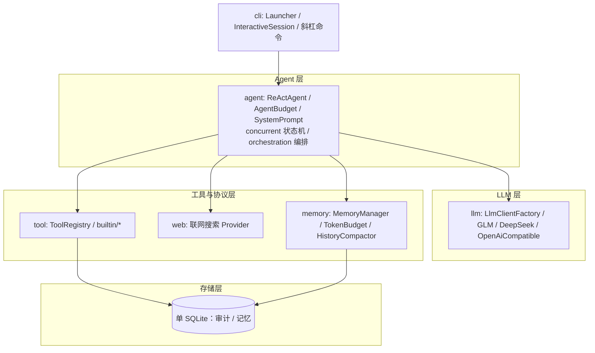

# 架构概览

AgentCLI 是纯 Java 单机应用，没有服务端、没有中间件。整体按**分层 + 单向依赖**组织，
每一层只向下依赖，禁止反向依赖与跨层穿透。

## 分层总览（ASCII）

```
┌─────────────────────────────────────────────────────────┐
│  cli          Launcher / InteractiveSession / 斜杠命令   │
├─────────────────────────────────────────────────────────┤
│  agent        ReActAgent / AgentBudget / SystemPrompt    │
├──────────────┬──────────────────────┬───────────────────┤
│  tool        │  llm                 │  memory           │
│  ToolRegistry│  LlmClientFactory    │  MemoryManager    │
│  builtin/*   │  Glm/DeepSeek/...    │  TokenBudget      │
│  web/*       │  OpenAiCompatible    │  HistoryCompactor │
├──────────────┴──────────────────────┴───────────────────┤
│  common       AppConfig / EnvLoader / PathGuard / ...    │
└─────────────────────────────────────────────────────────┘
```

## 分层依赖图



## 各层职责

| 层 | 包 | 职责 |
|---|---|---|
| CLI 层 | `cli` | 程序入口、REPL 交互、斜杠命令解析、流式控制台渲染 |
| Agent 层 | `agent`、`agent/concurrent`、`agent/orchestration` | ReAct 循环与预算控制；任务状态机、执行器、取消令牌与作用域；编排门面、worker 池、reviewer、结果聚合 |
| LLM 层 | `llm` | 多模型抽象与 SSE 流式客户端，`OpenAiCompatibleClient` 作为模板基类 |
| 工具与协议层 | `tool`、`web`、`memory` | 工具框架与内置工具、代码检索引擎；联网搜索 Provider；对话记忆、Token 预算、历史压缩 |
| 存储层 | 单 SQLite | 审计日志与长期记忆共用一个库，WAL 模式支撑崩溃恢复 |
| 公共层 | `common` | 配置、环境变量、安全围栏（路径沙箱 / 命令黑名单）、统一异常 |

## 源码目录

```
src/main/java/com/agentcli/
├── cli/        入口、REPL、命令解析、流式控制台
├── agent/      ReAct 循环、预算控制、系统提示词
│   ├── concurrent/     任务状态机、执行器、取消令牌与作用域
│   └── orchestration/  编排门面、worker 池、reviewer、结果聚合
├── llm/        多模型抽象与 SSE 客户端
├── tool/       工具框架、内置工具、代码搜索引擎
├── web/        联网搜索 Provider
├── memory/     对话记忆、Token 预算、历史压缩
└── common/     配置、环境变量、安全围栏、统一异常
```

---

依赖方向 `cli → agent → {tool, llm, memory} → common`，禁止反向依赖。

---

## 踩过的坑

真实开发里踩过、且值得写下来的三个坑，附当时的解法：

1. **重定向 SSRF 绕过**：只在入口校验一次目标地址，结果服务端 302 跳到 `169.254.169.254` 元数据地址就漏了。
   修法是**每一跳重定向都重新校验目标主机**，并把 IPv6 ULA、链路本地等容易被漏判的地址段一并纳入拒绝清单。
2. **服务端静默挂起导致 `interrupt()` 失效**：下游 HTTP 卡在读取、不抛异常也不结束，`thread.interrupt()` 唤醒不了阻塞在 I/O 上的线程。
   修法是取消同时走两路——**主动 `Call.cancel()` 断开底层 socket**，外加**协作轮询取消标志**让业务循环能自己退出，不只依赖中断信号。
3. **向量索引冷启动慢**：首次 RAG 检索要先建整库向量索引，首问延迟被拖到不可接受。
   修法是**全链路降级**——语义检索不可用时自动退回关键词检索，再不行退回类关系图谱，保证「慢一点」但「永远答得出来」，索引在后台慢慢补齐。
